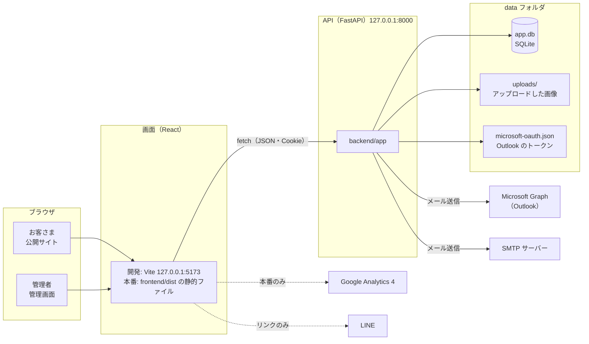
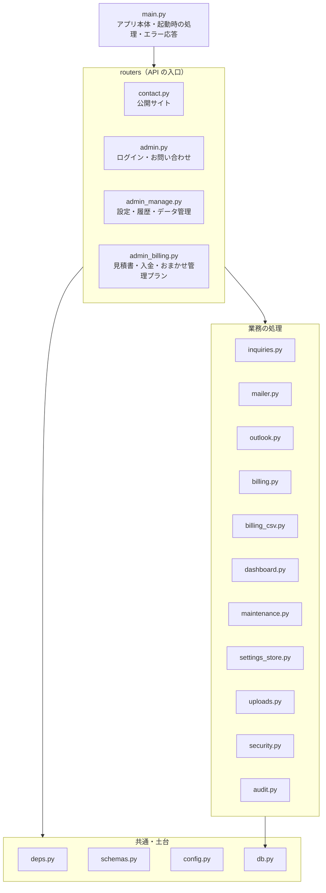

# 01 システム構成

## 1. システムの概要

ひとりで営むホームページ制作の事業（屋号: AI Nova ホームページ制作）の公式サイトです。

- **お客さま**は公開サイトで事業の内容・料金・経歴を見て、お問い合わせフォームまたは LINE で相談します。
- **管理者**（事業者本人の1人）は管理画面で、お問い合わせへの対応から、見積書・入金（領収書）・おまかせ管理プランの管理、公開サイトの文章や色の変更までを行います。
- フロントエンド（画面）は React（TypeScript・Vite）、バックエンド（API）は Python の FastAPI で作り、データは SQLite のデータベースに保存しています。

## 2. 全体の構成



- 画面と API は別のプロセス（別のポート）です。画面は API を `fetch` で呼び、管理画面のログインは Cookie で保ちます。
- 画面の切り替えはブラウザの中で行います（React Router の SPA）。API は画面の HTML を返しません。
- フォームの選択肢・対応状況・都道府県と、サイト内容の初期値は `shared/` の JSON にあり、画面と API の両方が同じファイルを読みます。

## 3. 使用技術

バージョンの書き方: `^19.1.0` は互換性のある範囲で新しいもの（19.1.0 以上 20.0.0 未満）、`~5.9.2` は小さな修正だけ新しいもの（5.9.2 以上 5.10.0 未満）、`==0.162.0` はその版だけです。「開発環境」は、2026-10-31 時点で開発環境に入っているバージョンです。

### 3.1 フロントエンド（画面）

#### 実行環境

| 名前 | バージョン | 内容 |
| --- | --- | --- |
| Node.js | 20.19 以上、または 22.12 以上（開発環境は 22.23.4） | 開発サーバーと本番用のビルドを動かす（公開したサイトの表示には使わない）。起動スクリプトがバージョンを確認し、足りなければ Node.js 24 を `~/.local/share/bluetab-tools` に用意する（[08 設定と運用](08_設定と運用.md)） |
| ブラウザ | Chrome・Edge 107 以上、Firefox 104 以上、Safari 16 以上 | 公開サイトと管理画面を表示する。範囲は Vite 7 の初期設定のまま（`vite.config.ts` では変えていない） |

#### `frontend/package.json` で入れるライブラリ

| 名前 | バージョンの指定 | 開発環境 | 用途 | 使っているところ |
| --- | --- | --- | --- | --- |
| React（`react`・`react-dom`） | `^19.1.0` | 19.3.1 | 画面の部品を作り、ブラウザに表示する | すべての画面（`pages/`・`components/`）。表示を始めるのは `main.tsx` |
| React Router（`react-router`） | `^7.9.0` | 7.18.4 | URL ごとの画面の切り替え、リンク、URL のパラメータ | `main.tsx`・`App.tsx`・`pages/`・`components/` |
| qrcode.react | `^4.2.0` | 4.2.0 | LINE ページの QR コード | `pages/LinePage.tsx` |
| react-icons | `^5.5.0` | 5.7.0 | アイコン（Material Design・Font Awesome） | `content/home.ts`・`pages/`・`components/` |
| TypeScript | `~5.9.2` | 5.9.3 | 型チェック（`npm run typecheck`、本番用のビルドの前） | `tsconfig.json`・`package.json` のスクリプト |
| Vite | `^7.1.0` | 7.3.7 | 開発サーバー、本番用のビルド（`frontend/dist/` に出力） | `vite.config.ts`・`run_backend.sh` |
| @vitejs/plugin-react | `^5.0.0` | 5.2.0 | Vite で React の JSX を変換し、開発中に保存した変更をすぐ画面に反映する | `vite.config.ts` |
| @types/react・@types/react-dom | `^19.1.0` | 19.3.0 | React の型の定義（TypeScript の型チェックに使う） | TypeScript が自動で読む |

TypeScript・Vite・@vitejs/plugin-react・@types は、開発とビルドのときだけ使います（devDependencies）。公開するファイル（`frontend/dist/`）には含まれません。

### 3.2 バックエンド（API）

#### 実行環境

| 名前 | バージョン | 内容 |
| --- | --- | --- |
| Python | 3.10 以上（開発環境は 3.14.4） | API を動かす。起動スクリプトがバージョンを確認し、仮想環境（`backend/.venv`）を作ってライブラリを入れる |

#### `backend/requirements.txt` で入れるライブラリ

| 名前 | バージョンの指定 | 開発環境 | 用途 | 使っているところ |
| --- | --- | --- | --- | --- |
| FastAPI | `==0.162.0`（固定） | 0.162.0 | API の本体。URL ごとの処理（ルーティング）、ログイン確認などの共通処理（`Depends`）、入力チェックの呼び出し、説明ページ `/api/docs` | `main.py`・`deps.py`・`routers/*.py` |
| Uvicorn | `==0.54.0`（固定） | 0.54.0 | API サーバー（API を動かすプログラム）。ソースからは使わず、起動のコマンドで使う | `run_backend.sh`・`tests/run_api_tests.sh` |

どちらも、API を動かすときに使います。

### 3.3 データベース

SQLite（Python 標準の `sqlite3`）。ファイルは `data/app.db` です（[05 データベース設計](05_DB設計.md)）。

### 3.4 外部サービス

| サービス | 用途 | 必要か |
| --- | --- | --- |
| Microsoft Graph（Outlook） | メール送信（標準の方法） | メールを送るには、Outlook と SMTP のどちらかが必要 |
| SMTP サーバー | メール送信（もう1つの方法） | 同上 |
| Google Analytics 4 | アクセス数の計測 | 任意（測定 ID を設定したときだけ） |
| LINE | 友だち追加 URL へのリンクと QR コード | 任意（URL を開くだけで、API の連携はしない） |

## 4. 実行環境とポート

| 用途 | 内容 |
| --- | --- |
| 開発環境 | Windows の WSL（Ubuntu）。プロジェクトは `C:\Users\document\python\company`（WSL では `/mnt/c/Users/document/python/company`） |
| API | `127.0.0.1:8000`（`.env` の `HOST`・`BACKEND_PORT`） |
| 画面 | `127.0.0.1:5173`（`frontend/.env.fastapi` の `DEV_PORT`） |
| API の説明ページ | `http://127.0.0.1:8000/api/docs`（Swagger UI）、`/api/openapi.json` |
| API テスト | API `127.0.0.1:18000`、偽の Microsoft サーバー `127.0.0.1:18999` |

## 5. フォルダ構成

```
company/                          … プロジェクトのルート（git で管理）
├── backend/
│   ├── app/                      … API のソース（6.1）
│   │   └── routers/              … API の入口（URL ごとの処理）
│   ├── requirements.txt          … Python パッケージ（バージョン固定）
│   └── .venv/                    … Python の仮想環境（自動で作成・git 管理外）
├── frontend/
│   ├── public/                   … そのまま配信するファイル（logo-mark.png・ogp.png・images/）
│   ├── src/                      … 画面のソース（6.2）
│   ├── index.html                … HTML のひな形（タイトル・説明文・OGP）
│   ├── .env.fastapi              … 画面の設定（API の接続先・ポート・公開 URL・GA4）
│   ├── package.json / package-lock.json
│   ├── tsconfig.json
│   └── vite.config.ts            … Vite の設定（OGP 画像のタグ・開発サーバー）
├── shared/
│   ├── contact_options.json      … 選択肢・対応状況・都道府県（画面と API で共通）
│   └── site_defaults.json        … テーマ色とサイト内容の初期値（画面と API で共通）
├── data/                         … 動かしているときのデータ
│   ├── app.db                    … SQLite のデータベース（git 管理外）
│   ├── uploads/                  … 管理画面でアップロードした画像
│   └── microsoft-oauth.json      … Outlook のトークン（git 管理外）
├── docs/詳細設計書/               … この設計書
├── scripts/common.sh             … 起動・テストのスクリプトの共通処理
├── tests/
│   ├── run_api_tests.sh          … API テストの実行
│   └── api_test.py               … API テストの本体
├── run_backend.sh                … API と画面をまとめて起動
├── .env.example                  … .env のひな形
└── .env                          … API の設定（初回の起動時に自動で作成・git 管理外）
```

## 6. モジュール構成

### 6.1 API（backend/app）



| ファイル | 役割 |
| --- | --- |
| `main.py` | アプリ本体。起動時の処理（DB の準備・管理者の反映・期限切れセッションの削除・自動削除の定期処理の開始）、エラー応答の形、応答ヘッダー、CORS、ルーターの登録、動作確認 API、定義されていないパスの 404 |
| `config.py` | `.env` と `shared/contact_options.json` の読み込み（`Settings`）。OS の環境変数があれば `.env` より優先 |
| `deps.py` | ルーター共通の処理。設定・DB 接続（`get_conn`）・ログイン確認（`require_admin`）・エラー（`ApiError`）・試行回数の制限・ID とページ番号の解釈・Outlook の設定 |
| `db.py` | SQLite の接続、マイグレーション（`init_db`）、日時の関数、ページ分け（`paginate`） |
| `schemas.py` | API の入出力の型（Pydantic）。管理画面からの入力のチェック |
| `security.py` | パスワードのハッシュ、起動時の管理者の反映（`sync_admin`）、ログイン認証、セッション、ログイン履歴、試行回数の制限（`RateLimiter`） |
| `inquiries.py` | お問い合わせの入力チェックと整形・保存・一覧（絞り込み・並び替え・ページ分け）・メモ・CSV、ブロック判定 |
| `mailer.py` | メール送信。送信方法の判断、送信履歴への登録・送信・結果の記録、新着通知と自動返信の本文、差し込み項目の置き換え、SMTP 送信 |
| `outlook.py` | Microsoft Graph。デバイスコードでのサインイン、トークンの保存と更新、送信 |
| `outlook_login.py` | コマンドで Outlook にサインインする（`python -m app.outlook_login`） |
| `billing.py` | 見積書・入金・おまかせ管理プラン。金額の計算、番号の採番、おまかせ管理プランの状態の判定、解約日の計算 |
| `billing_csv.py` | 見積書・入金の CSV 出力（列の並びとラベル） |
| `dashboard.py` | ダッシュボードの集計 |
| `maintenance.py` | 自動削除（対象の抽出・削除）、バックアップ zip の作成 |
| `settings_store.py` | `settings` 表の読み書き、設定の初期値、サイト内容（`shared/site_defaults.json`） |
| `uploads.py` | 画像の種類の判定・保存・取得 |
| `audit.py` | 操作の記録 |
| `routers/contact.py` | 公開サイト用の API（お問い合わせ受付・サイト内容・画像） |
| `routers/admin.py` | ログイン・アカウント・お問い合わせの API |
| `routers/admin_manage.py` | ダッシュボード・履歴・データ管理・デザイン・サイト内容・画像のアップロード・メール・返信テンプレート・ブロックリストの API |
| `routers/admin_billing.py` | 見積書・入金・おまかせ管理プランの API（見積書・入金の CSV ダウンロードを含む） |

### 6.2 画面（frontend/src）

| ファイル | 役割 |
| --- | --- |
| `main.tsx` | 入口。アクセス解析の開始、ルーター（`BrowserRouter`）、サイト内容の読み込み（`SiteProvider`）、CSS の読み込み |
| `App.tsx` | URL と画面の対応（ルーティング） |
| `api/client.ts` | API の呼び出しをまとめたもの。接続先の決定、エラー（`ApiError`）、ファイルのダウンロード、API の型 |
| `lib/SiteContext.tsx` | 公開サイトの表示内容（テーマ色・サイト内容）を読み込み、各画面に配る |
| `lib/site.ts` | サイト内容の型と初期値（`shared/site_defaults.json`） |
| `lib/options.ts` | 選択肢（`shared/contact_options.json` と、画面だけで使う選択肢） |
| `lib/theme.ts` | テーマ色の計算（CSS 変数・コントラスト比・読みやすい濃さへの調整・ファビコン） |
| `lib/format.ts` | 日時・日付・金額の表示 |
| `lib/usePageTitle.ts` | ブラウザのタブ名 |
| `lib/analytics.ts` | Google Analytics 4 |
| `lib/useActiveSection.ts` | トップページで今見ているエリアの判定（ページ上部のメニューの強調に使う） |
| `content/home.ts` | トップページの文言のうち、管理画面で変えられない部分。タブ名（`HOME_TITLE`）、ページ上部のメニューとボタン（`NAV`・`HEADER_CTA`）、対応エリア（`SERVICE_AREA`） |
| `components/PublicLayout.tsx` | 公開サイトの外枠（テーマ色の反映） |
| `components/SubPageLayout.tsx` | 下層ページの外枠（ロゴ・本文・トップへ戻るボタン） |
| `components/Logo.tsx` | ロゴ（チップと歯車のアイコン。画像は public/logo-mark.png） |
| `components/SectionHeading.tsx` | トップページの見出し |
| `components/ScrollManager.tsx` | 画面を移動したときのスクロール、リロード時の位置の復元 |
| `components/PrivacyPolicy.tsx` | 個人情報の取扱いの本文 |
| `components/admin/ui.tsx` | 管理画面の共通部品（見出し・カード・お知らせ・ページ送り・入力欄・タブ・読み込みと操作のフック） |
| `components/admin/MonthlyChart.tsx` | ダッシュボードの月ごとのグラフ |
| `pages/*.tsx` | 公開サイトの画面（[02](02_画面設計_公開サイト.md)） |
| `pages/admin/*.tsx` | 管理画面の画面（[03](03_画面設計_管理画面.md)） |
| `styles/base.css` | 共通のスタイル・色の変数（`:root`） |
| `styles/home.css` / `styles/pages.css` | トップページ / 下層ページ |
| `styles/admin.css` | 管理画面・印刷用ページ |

### 6.3 共通のファイル（shared）

| ファイル | 内容 | 読むところ |
| --- | --- | --- |
| `contact_options.json` | ご相談内容（topics）、初期費用のお支払い方法（initial_payments）、月額のお支払い方法（monthly_payments）、対応状況（statuses）、都道府県（prefectures） | API: `config.py`（入力チェック・CSV・メール本文のラベル）/ 画面: `lib/options.ts` |
| `site_defaults.json` | テーマ色と、サイト内容6項目の初期値 | API: `settings_store.py` / 画面: `lib/site.ts` |

## 7. プロセスと処理のタイミング

| 処理 | タイミング | 内容 |
| --- | --- | --- |
| 起動時の準備 | API の起動時 | DB の表を用意（マイグレーション）→ `.env` の管理者を反映 → 期限切れのセッションを削除 → 自動削除の定期処理を開始。管理者の設定が正しくなければ起動しない |
| 自動削除 | 起動の10秒後、その後は24時間ごと | 設定で有効にしたときだけ、古いお問い合わせを削除する（[06](06_処理設計.md) 11章） |
| メール送信（お問い合わせの受付後） | お問い合わせの応答を返したあと | 新着通知・自動返信を順番に送る（FastAPI の BackgroundTasks） |
| メール送信（返信・テスト・送り直し） | 管理画面で操作したとき | その場で送り、結果を応答で返す |

- API は1つのプロセスで動かします（ワーカーを増やしません）。試行回数のカウントと、Outlook サインインの途中の情報を、プロセスのメモリに持つためです（[08](08_設定と運用.md) の運用上の注意）。
- DB への接続は、API のリクエストごとに開いて、終わったら閉じます。

## 8. 本番の構成（前提）

| 項目 | 内容 |
| --- | --- |
| 画面 | `npm run build:fastapi` で作った `frontend/dist/` を、静的ファイルとして配信する。どの URL でも `index.html` を返す設定が必要（`/contact` などの URL を直接開いたときも、画面側で切り替えるため） |
| API | Uvicorn で起動する（1プロセス） |
| ドメイン | 画面と API を同じドメインの配下にする（例: `www.example.com` と `api.example.com`）。ログインの Cookie を `SameSite=Strict` で使うため |
| 通信 | HTTPS。`.env` の `COOKIE_SECURE=true` |
| 接続元の許可 | `.env` の `FRONTEND_ORIGINS` に、公開する画面の URL を書く |

くわしくは「[08 設定と運用](08_設定と運用.md)」に書いています。
