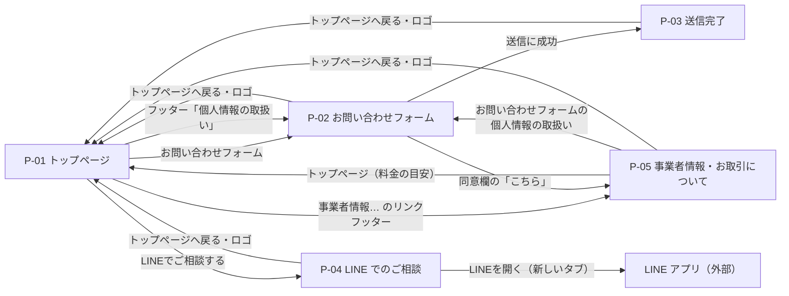

# 02 画面設計（公開サイト）

## 1. 画面一覧

| ID | 画面名 | URL | 概要 | 使う API | ソース |
| --- | --- | --- | --- | --- | --- |
| P-01 | トップページ | `/` | 事業の紹介・料金・制作実績・よくある質問・ご相談の入口 | API-04、API-05（画像） | `pages/HomePage.tsx` |
| P-02 | お問い合わせフォーム | `/contact` | お問い合わせの入力と送信 | API-03 | `pages/ContactPage.tsx` |
| P-03 | 送信完了 | `/contact/complete` | 受け付けたことを伝える | なし | `pages/ContactCompletePage.tsx` |
| P-04 | LINE でのご相談 | `/line` | LINE の友だち追加（QR コード・ボタン） | なし | `pages/LinePage.tsx` |
| P-05 | 事業者情報・お取引について | `/tokushoho` | 特定商取引法に基づく表記と、お金・契約のルール | なし | `pages/TokushohoPage.tsx` |
| P-06 | ページが見つかりません | 上記以外の URL（`/admin` 以下を除く） | 404 の案内 | なし | `pages/NotFoundPage.tsx` |

API-04（テーマ色とサイト内容）は、どの画面を開いても最初に1回だけ呼びます（3.1）。

## 2. 画面遷移

- 送信完了（P-03）へは、ブラウザの履歴を置き換えて移動します（戻るボタンでフォームに戻らない）。
- フッターの「個人情報の取扱い」は `/contact#privacy`（フォームの同意欄の位置）を開きます。

## 3. 共通の仕様

### 3.1 サイト内容の読み込み（`lib/SiteContext.tsx`）

| 項目 | 内容 |
| --- | --- |
| タイミング | 画面を最初に開いたとき1回（管理画面でサイト内容・テーマ色を保存したときは、もう1回読み込む） |
| 呼ぶ API | API-04 `GET /api/site` |
| 成功したとき | テーマ色とサイト内容を、受け取った値に置き換える |
| 失敗したとき | エラーは表示せず、初期値（`shared/site_defaults.json`）のまま表示する |
| 初期表示の色 | 前回に受け取ったテーマ色をブラウザ（localStorage の `bt-theme-color`）に保存しておき、次に開いたときの最初の色に使う（色のちらつきを防ぐ）。保存できない環境でも表示には影響しない |

### 3.2 テーマ色の反映（`components/PublicLayout.tsx`・`lib/theme.ts`）

- 公開サイトの画面だけを `public-theme` の枠で囲み、テーマ色から作った CSS 変数を上書きします（計算方法は [06 処理設計](06_処理設計.md) 19章）。
- テーマ色が初期の青（`#1558c0`）のときは上書きせず、CSS の元の色をそのまま使います。
- ブラウザのタブのアイコン（ファビコン）と、アドレスバーの色（`meta[name="theme-color"]`）もテーマ色に合わせます。

### 3.3 下層ページの外枠（`components/SubPageLayout.tsx`）

P-02〜P-06 で使います。

| エリア | 内容 |
| --- | --- |
| ヘッダー | ロゴ（押すとトップページ） |
| 本文 | 本文の幅は画面ごとに決める。`line`=560px（P-04）/ `form`=640px（P-02・P-03・P-06）/ `doc`=760px（P-05） |
| 下部 | 「トップページへ戻る」ボタン |

### 3.4 そのほか

| 項目 | 内容 |
| --- | --- |
| タブ名 | トップページは `HOME_TITLE`（「大阪・本町のホームページ制作｜AI Nova（個人事業主・店舗・中小企業）」）。ほかの画面は「{画面名} \| {屋号}」 |
| スクロール | 画面を移動したら先頭へ。URL に `#` が付いていれば、その ID の場所へ移動し、URL から `#` を消す。リロードしたときは、リロード前に見ていた位置のまま表示する（位置はページを離れる直前に sessionStorage へ保存）。トップページ内の `#〜` リンクは URL を変えずにスクロールだけする（リロードで勝手に移動しないため。移動先が受賞・スキルの行き先なら2秒ほど光らせる）（`components/ScrollManager.tsx`、`HomePage.tsx`）。トップページでは、画面上部に固定したヘッダーに隠れないよう、ヘッダーの高さの分だけ下の位置で止める |
| 画面の幅 | トップページは 1140px・960px・760px・420px・360px、下層ページは 640px で、レイアウトを切り替える |
| 検索・SNS 向けの情報 | `index.html` にタイトル・説明文・OGP（og:type・og:site_name・og:title・og:description・og:locale・twitter:card）を書く。`frontend/.env.fastapi` の `SITE_URL` があるときは、ビルド時に og:image（`{SITE_URL}/ogp.png`・1200×630）を追加する |
| アクセス解析 | `VITE_GA_ID` があり、本番用のビルドで、手元（localhost・127.0.0.1）ではなく、`/admin` 以外の URL で開いたときだけ GA4 を読み込む（[06](06_処理設計.md) 20章） |

## 4. 各画面

### 4.1 P-01 トップページ

#### 画面の構成

上から順に並びます。「出どころ」が「サイト内容」のものは管理画面（A-11）で変えられ、`content/home.ts` のものはソースを書き換えて変えます。

| No. | エリア（ID） | 内容 | 出どころ |
| --- | --- | --- | --- |
| 1 | ヘッダー | ロゴ（縦並び）、ページ内メニュー（特長・対応内容・経歴・制作実績・料金・安心のお約束・制作の流れ・よくある質問 → 各エリアへ移動）、ボタン「ご相談はこちら」（→ ご相談エリア）。幅 1140px 以上は 1 行、それより狭いとロゴとボタンの下にメニューを 1 行、760px 以下はメニューを 4 列×2 段のタイルで表示。画面上部に固定する（760px 以下はロゴとボタンの行だけ）。今見ているエリアのメニューは青字＋下線にする。今見ているエリアは、先頭が画面の上から 30% の位置より上に来ているエリアのうち、いちばん下のもの。特長エリアより上とご相談エリアでは、どのメニューも強調しない（`lib/useActiveSection.ts`） | `content/home.ts` の `NAV`・`HEADER_CTA` |
| 2 | ファーストビュー | キャッチコピー、説明文、ボタン「無料でご相談する」（→ ご相談エリア）・「経歴を見る」（→ 経歴エリア）、「ご相談・お見積りは無料」「見積書の金額以外は請求しません」 | ソースに直接 |
| 3 | 制作者のプロフィール | 学歴・職歴の要約、受賞のバッジ（金賞・カプコン賞）、スキル。受賞とスキルは押すと関係する場所へ移動し、2秒ほど光らせる（受賞→制作実績の同じバッジの賞状カード、無ければ制作実績の先頭／スキル→経歴の該当する行） | ソース / `AWARDS`・`SKILLS` |
| 4 | 実績の数字 | 4年間・2回・1年間・1人 | `STATS` |
| 5 | 特長（`#strength`） | 3つのカード | `STRENGTHS` |
| 6 | 対応内容（`#service`） | 6つのカード | `SERVICES` |
| 7 | 経歴（`#profile`） | 年表（IT専門学校 → 就労支援事業所 → Webスクール → IT開発会社 → 現在）。「現在」は強調して表示 | `CAREER` |
| 8 | 制作実績（`#works`） | 画像・バッジ・タイトル・説明のカード。0件ならカードの部分を出さない。バッジの色は1件目・2件目…で交互（テーマ色に連動） | サイト内容 `works` |
| 9 | そのほかの制作物 | チェックマーク付きの箇条書き（押せない。PC は 2 列、760px 以下は 1 列）。0件なら見出しごと出さない | サイト内容 `other_works` |
| 10 | お客さまの声 | 「公開する」にしたものだけを表示。1件もなければ「お客さまの声は、実際にいただいたものだけを載せます。…」の案内を出す | サイト内容 `testimonials` |
| 11 | 料金の目安（`#price`） | 「制作内容」「1ページの相場」の表（右上に「表示価格はすべて税抜」のバッジ）と、表の下の補足 | サイト内容 `prices` |
| 12 | 安心のお約束（`#trust`） | 5つのカードと、P-05 へのリンク | `PROMISES` |
| 13 | 制作の流れ（`#flow`） | STEP 1〜5 | `FLOW` |
| 14 | よくある質問（`#faq`） | 質問を押すと回答が開く（`details`）。0件ならエリアごと出さない | サイト内容 `faq` |
| 15 | ご相談（`#contact`） | 「フォームでご相談」（→ P-02）と「LINEでご相談」（→ P-04）のカード、対応時間（事業者情報の対応時間）、対応エリア、「ご相談の内容によっては、お受けできない場合もあります。…」 | サイト内容 `business.hours` / `SERVICE_AREA` |
| 16 | フッター | 「事業者情報・お取引について」（→ P-05）、「個人情報の取扱い」（→ `/contact#privacy`）、「© {今年} {屋号}」 | サイト内容 `business.business_name` |

#### 画像の読み込み

- 制作実績の画像の URL が `/uploads/` で始まるときは API サーバーから（`{API の URL}/uploads/...`）、それ以外（`/images/...`）は画面側から読み込みます（`api/client.ts` の `assetUrl`）。
- 画像は `loading="lazy"`（画面に近づいてから読み込む）です。

### 4.2 P-02 お問い合わせフォーム

#### 画面の構成

| エリア | 内容 |
| --- | --- |
| 見出し | 「お問い合わせフォーム」と説明文 |
| エラーの表示 | フォームの上部（`role="alert"`） |
| 入力欄 | 下の項目定義のとおり |
| 個人情報の取扱い（`#privacy`） | 全文を枠内に表示し、最後まで読むと「同意する」を押せる |
| 送信ボタン | 「お問い合わせ送信」と、「「同意する」にチェックを入れると、送信できます。」 |

#### 項目定義

画面のチェックは、API（[06](06_処理設計.md) 2.2）と同じルールです。最終的なチェックは API で行います。

| No. | 項目名 | 入力欄 | 必須 | 長さ・範囲 | 初期値 | 画面でのチェックとエラー文 |
| --- | --- | --- | --- | --- | --- | --- |
| 1 | ご相談内容 | チェックボックス（複数選べる） | ○ | 選択肢は `contact_options.json` の topics（今は「Python(React/FastAPI)」の1つ） | なし | 1つも選ばない →「ご相談内容を選択してください。」 |
| 2 | お名前 | テキスト（autocomplete=name） | ○ | 100文字 | 空 | 前後の空白を除いて、空 →「お名前を入力してください。」、100文字より長い →「お名前は100文字以内で入力してください。」 |
| 3 | メールアドレス | メール（inputmode=email） | ○ | 254文字 | 空 | 全角を半角にしてから判定。空 →「メールアドレスを入力してください。」、形式が違う・254文字より長い →「メールアドレスの形式が正しくありません。」 |
| 4 | 電話番号 | 電話（inputmode=tel） | ○ | 入力は20文字まで | 空（プレースホルダー「例:09012345678」） | 全角を半角にし、空白・ハイフン類・長音・かっこを除いて「0で始まる10〜11桁の数字」か。空 →「電話番号を入力してください。」、違う →「電話番号の形式が正しくありません（例:09012345678）。」 |
| 5 | お住まい | セレクト | ○ | 47都道府県 | 「選択」 | 選ばない →「お住まいを選択してください。」 |
| 6 | ご年齢 | テキスト（inputmode=numeric） | − | 3文字、1〜120 | 空（プレースホルダー「例:30」） | 全角は半角にする。数字以外 →「ご年齢は数字で入力してください。」、範囲外 →「ご年齢は1〜120の範囲で入力してください。」 |
| 7 | 初期費用のお支払い方法 | ラジオボタン | ○ | 手渡し / クレジットカード | なし | 選ばない →「初期費用のお支払い方法を選択してください。」 |
| 8 | 月額5,000円(税込・おまかせ管理プラン)のお支払い方法 | ラジオボタン | ○ | クレジットカードの自動決済 / おまかせ管理プランなし | なし | 選ばない →「月額(おまかせ管理プラン)のお支払い方法を選択してください。」 |
| 9 | 個人情報の取扱い（全文） | スクロールできる枠 | − | − | − | 枠の下端から8px以内までスクロールすると、No.10 を押せるようになる |
| 10 | 同意する | チェックボックス | ○ | − | オフ（押せない） | オフ →「「個人情報の取扱い」への同意が必要です。」 |
| 11 | 隠し欄（website） | テキスト。画面に見えず、Tab キーでも移動しない（`aria-hidden`） | − | − | 空 | 画面ではチェックしない（API で判定。[06](06_処理設計.md) 2.1） |
| 12 | お問い合わせ送信 | ボタン | − | − | 押せない | No.10 がオンのときだけ押せる。送信中は「送信しています…」になり押せない |

入力欄の下の説明:

- 電話番号:「ハイフンはあってもなくても大丈夫です。」
- 月額のお支払い方法:「おまかせ管理プランをご希望の方は、「クレジットカードの自動決済」をお選びください。ご不要の方は、「おまかせ管理プランなし」をお選びください。カード番号などは、このフォームには入力しないでください。決済の手続きは、あらためてご案内します。」
- 同意欄:「下の枠内を最後までお読みのうえ、「同意する」にチェックを入れてください。」。枠の下に、スクロール前は「最後までスクロールすると、チェックできます。」、スクロール後は「最後までお読みいただき、ありがとうございます。」

同意のチェックの下の文:

- 現在、日本国内にお住まいで、日本語でやり取りができる方からのご依頼をお受けしています。
- 反社会的勢力に当てはまる方や、法令・公序良俗に反するご依頼は、お受けしていません。
- 事業者情報やキャンセルについては「こちら」（→ P-05）です。

#### イベント

| No. | イベント | 処理 |
| --- | --- | --- |
| E1 | 画面を開く | 同意欄のスクロール位置を1回判定する（枠の中身が短く、スクロールしなくても最後まで見えている場合のため） |
| E2 | 入力を変える | 値を更新し、その項目のエラーを消す |
| E3 | 個人情報の枠をスクロール | 最後まで来たら「同意する」を押せるようにする（一度押せるようになったら、戻しても押せるまま） |
| E4 | 「お問い合わせ送信」 | 1. 送信中なら何もしない（二重送信を防ぐ） 2. 画面でチェックする。エラーがあれば、上部に「入力内容をご確認ください。」、各項目の下にエラー文を出し、最初のエラーの入力欄にカーソルを移す（順番: ご相談内容 → お名前 → メール → 電話 → お住まい → ご年齢 → 初期費用 → 月額 → 同意） 3. API-03 に送る（`agreed` と隠し欄の値も含める） 4. 成功 → P-03 へ（履歴を置き換え） 5. 失敗 → API のメッセージを上部に出す。422 なら各項目にエラー文を出し、最初のエラーの入力欄にカーソルを移す |

#### API のエラーと表示

| 場合 | 上部に出る文 |
| --- | --- |
| 入力エラー（422） | 「入力内容をご確認ください。」（各項目の下にもエラー文） |
| 送信が多すぎる（429） | 「送信回数が多すぎます。しばらくしてからお試しください。」 |
| 通信できない | 「通信に失敗しました。接続を確認して、もう一度お試しください。」 |
| そのほか | API のメッセージ、なければ「エラーが発生しました（{コード}）。」 |

#### 個人情報の取扱い（`components/PrivacyPolicy.tsx`）

枠の中に、次の見出しで表示します。屋号・運営責任者・メール・対応時間はサイト内容の事業者情報から入れます。

1. 取得する情報（お名前・メール・電話番号、お住まい、ご年齢（任意）、ご相談内容、お支払い方法の選択。カード番号などは取得しない）
2. 利用目的（ご返信、お見積り・ご契約・制作・保守のご連絡）
3. 第三者への提供（法令にもとづく場合を除き、同意なく提供しない）
4. 管理と削除（適切に管理し、不要になった情報は削除する）
5. 開示・訂正・削除のご依頼
6. アクセス解析について（`VITE_GA_ID` を設定したときだけ。Google アナリティクスの説明・ポリシーとオプトアウトへのリンク）
7. お問い合わせ窓口（アクセス解析がないときは 6）

### 4.3 P-03 送信完了

| 項目 | 内容 |
| --- | --- |
| 表示 | チェックのアイコン、「お問い合わせを受け付けました」、「ご相談・ご質問をお送りいただき、ありがとうございます。内容を確認して、ご連絡します。」（`role="status"`） |
| タブ名 | 「送信が完了しました \| {屋号}」 |

### 4.4 P-04 LINE でのご相談

| 項目 | 内容 |
| --- | --- |
| QR コード | サイト内容の `business.line_url` から作る（186px・誤り訂正レベル M・余白なし） |
| 「LINEを開く」ボタン | `line_url` を新しいタブで開く（`rel="noopener noreferrer"`） |
| 文言 | 「QRコードをスマホのLINEで読み取ると、友だち追加ができます。…」など |

### 4.5 P-05 事業者情報・お取引について

#### 事業者情報（特定商取引法に基づく表記）の表

| 項目 | 表示する内容 |
| --- | --- |
| 屋号 / 運営責任者 / 所在地 / 電話番号 / メールアドレス / 対応時間 / 事業形態 | サイト内容の事業者情報（`business`） |
| サービス内容 | ホームページの企画・制作、システム開発、公開後の保守 |
| 販売価格 | ご相談内容に応じて、お見積書に記載（料金の目安は P-01 の `#price` へのリンク）。おまかせ管理プランは月額5,000円(税込・税抜4,546円) |
| 代金以外の費用 | ドメイン・サーバー等の実費が必要な場合は、お見積書に明記 |
| お支払い方法 | 初期費用: 手渡し、またはクレジットカード / 月額: クレジットカードの自動決済 |
| お支払い時期 | ご契約時に50%、納品時に50%（お見積書に記載） |
| 納期 | お見積り時にお伝えします |
| キャンセル・返金 | 下の「キャンセルと返金について」を参照 |

#### 表のあとの文章（ソースに直接書いた固定の文章）

お金の流れについて / キャンセルと返金について（`#cancel`）/ 権利・納品・保守について / 反社会的勢力の排除について / ご依頼いただける方について / お受けできないご依頼 / 個人情報の取扱い（P-02 の `#privacy` へのリンク）

### 4.6 P-06 ページが見つかりません

「ページが見つかりません」「お探しのページは、移動または削除された可能性があります。」を表示します。管理画面（`/admin` 以下）の未定義の URL は、管理画面の中で案内します（[03](03_画面設計_管理画面.md)）。
