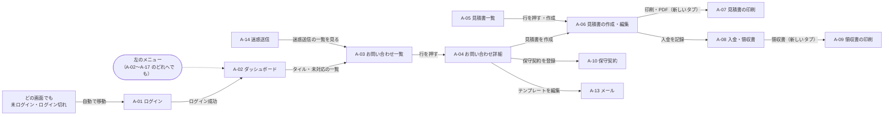

# 03 画面設計（管理画面）

## 1. 画面一覧

| ID | 画面名 | URL | 概要 | 使う API | ソース（`pages/admin/`） |
| --- | --- | --- | --- | --- | --- |
| A-01 | 管理者ログイン | `/admin/login` | メールアドレスとパスワードでログイン | API-06、API-08 | `AdminLoginPage.tsx` |
| A-02 | ダッシュボード | `/admin` | 件数・金額の集計、月ごとのグラフ、未対応の一覧 | API-18 | `AdminDashboardPage.tsx` |
| A-03 | お問い合わせ一覧 | `/admin/inquiries` | 絞り込み・検索・並び替え・CSV | API-10、API-11 | `AdminInquiriesPage.tsx` |
| A-04 | お問い合わせ詳細 | `/admin/inquiries/:id` | 内容、対応状況、返信、メモ、迷惑送信、削除 | API-12〜17、API-36、API-47、API-52 | `AdminInquiryDetailPage.tsx` |
| A-05 | 見積書一覧 | `/admin/estimates` | 状態の絞り込み・検索 | API-54 | `AdminEstimatesPage.tsx` |
| A-06 | 見積書の作成・編集 | `/admin/estimates/new` `/admin/estimates/:id` | 基本情報・明細・備考、この見積書の入金 | API-12、API-55〜58 | `AdminEstimateEditPage.tsx` |
| A-07 | 見積書の印刷 | `/admin/estimates/:id/print` | 印刷・PDF 用（A4） | API-56 | `PrintPages.tsx` |
| A-08 | 入金・領収書 | `/admin/payments` | 入金の記録・一覧・検索 | API-54、API-59、API-60、API-62、API-63 | `AdminPaymentsPage.tsx` |
| A-09 | 領収書の印刷 | `/admin/payments/:id/receipt` | 印刷・PDF 用（A4） | API-61 | `PrintPages.tsx` |
| A-10 | 保守契約 | `/admin/contracts` | 契約の登録・一覧・解約の申し出 | API-12、API-64、API-65、API-67〜69 | `AdminContractsPage.tsx` |
| A-11 | サイト内容 | `/admin/content` | 公開サイトの事業者情報・料金・よくある質問など | API-27〜35 | `AdminContentPage.tsx` |
| A-12 | デザイン（色） | `/admin/theme` | 公開サイトのテーマ色 | API-25、API-26 | `AdminThemePage.tsx` |
| A-13 | メール | `/admin/mail` | 送信設定・通知と自動返信・返信テンプレート・送信履歴 | API-36〜50 | `AdminMailPage.tsx` |
| A-14 | 迷惑送信 | `/admin/spam` | ブロックするアドレス・ドメイン | API-51〜53 | `AdminSpamPage.tsx` |
| A-15 | 履歴 | `/admin/logs` | 操作の記録・ログイン履歴 | API-19、API-20 | `AdminLogsPage.tsx` |
| A-16 | データ管理 | `/admin/data` | バックアップ・個人情報の自動削除 | API-21〜24 | `AdminDataPage.tsx` |
| A-17 | アカウント | `/admin/account` | パスワードの変更 | API-09 | `AdminAccountPage.tsx` |

上記のほかの `/admin/...` の URL は、管理画面の中に「ページが見つかりません。左のメニューから選んでください。」と表示します。

## 2. 画面遷移

- ログアウトすると A-01 に移ります。
- 見積書・領収書の印刷（A-07・A-09）は、左のメニューのない画面です。新しいタブで開きます。

## 3. 共通の仕様

### 3.1 外枠（`AdminLayout.tsx`）

| エリア | 内容 |
| --- | --- |
| ヘッダー | ロゴ（「管理画面」・押すとダッシュボード）、「サイトを見る」（公開サイトを新しいタブで）、ログイン中のメールアドレス、「ログアウト」 |
| 左のメニュー | ダッシュボード / お問い合わせ / 見積書 / 入金・領収書 / 保守契約 / サイト内容 / デザイン（色）/ メール / 迷惑送信 / 履歴 / データ管理 / アカウント（今の画面を強調） |
| 本文 | 各画面 |

### 3.2 ログインの確認

1. 外枠を表示したときに API-08（`GET /api/admin/me`）を呼びます。
2. 401 なら A-01 に移ります（履歴を置き換え）。それ以外のエラーは本文の上にメッセージを出します。
3. ログインが確認できるまで、本文（各画面）は表示しません。

### 3.3 API のエラーの扱い（`handleApiError`）

| 場合 | 動き |
| --- | --- |
| 401（ログイン切れ） | A-01 に移り、「ログインの有効期限が切れました。もう一度ログインしてください。」を表示する |
| そのほか | API のメッセージを、その画面のお知らせ欄に出す |
| 入力エラー（422） | 上に加えて、`errors` の内容を各入力欄の下に出す。キーは項目名。リストの項目は「行番号.項目名」（例: `items.0.quantity` は明細の1行目の数量）。項目にひもづかないエラーはキー `body` |

### 3.4 共通部品（`components/admin/ui.tsx`）

| 部品 | 内容 |
| --- | --- |
| PageHeader | 画面の見出し・説明・右上のボタン |
| Card | 見出しつきの枠 |
| Notice | お知らせ（info・success・error・warning）。error は `role="alert"`、ほかは `role="status"`。中身が空なら表示しない |
| Pagination | 「前へ」「{n} / {m} ページ」「次へ」。1ページしかないときは表示しない |
| Field | 入力欄のラベル・必須の印・説明・エラー文 |
| Tabs | タブの切り替え |
| Pill | 状態などの小さな印 |
| Empty | 「読み込み中…」「まだありません」などの表示 |
| useLoader | API からの読み込み（読み込み中・エラー・再読み込み） |
| useAction | ボタンの処理（処理中・成功のメッセージ・エラー・項目ごとのエラー） |

### 3.5 そのほか

| 項目 | 内容 |
| --- | --- |
| 色 | 管理画面は、テーマ色を変えても初期の青のまま（ファビコンも青） |
| 一覧 | 20件ごとのページ分け、「全 {n} 件」。お問い合わせ・見積書は行を押すと詳細へ |
| 確認 | 削除・メール送信など元に戻せない操作は、ブラウザの確認ダイアログ（`window.confirm`）で確認する |
| タブ名 | 「{画面名} \| {屋号}」 |
| 画面の幅 | 1100px 以下で2列のレイアウトを1列に、900px 以下で左のメニューを上に、760px 以下で表をカードの形にする（各セルに見出しを表示）。入力欄の2列も1列にする |
| 状態の保存 | 一覧の絞り込み・タブなどは、できるだけ URL のパラメータに持つ（再読み込み・共有しても同じ表示になる） |

## 4. 各画面

### 4.1 A-01 管理者ログイン

| No. | 項目名 | 入力欄 | 備考 |
| --- | --- | --- | --- |
| 1 | メールアドレス | メール（autocomplete=username、最初にカーソル） | |
| 2 | パスワード | パスワード（autocomplete=current-password） | |
| 3 | ログイン | ボタン | 処理中は「ログイン中…」で押せない |

| No. | イベント | 処理 |
| --- | --- | --- |
| E1 | 画面を開く | API-08 を呼び、すでにログインしていれば A-02 へ移る。ログイン切れで来たときは、上部に「ログインの有効期限が切れました。もう一度ログインしてください。」 |
| E2 | ログイン | 1. どちらかが空なら「メールアドレスとパスワードを入力してください。」 2. API-06 を呼ぶ 3. 成功 → A-02 へ（履歴を置き換え） 4. 失敗 → API のメッセージ（「メールアドレスまたはパスワードが正しくありません。」「ログインの試行回数が多すぎます。しばらくしてからお試しください。」など） |

### 4.2 A-02 ダッシュボード

| No. | 表示 | 内容 | 押したとき |
| --- | --- | --- | --- |
| 1 | 前回のログイン | 見出しの下に「前回のログイン: {日時}（{IP}）」。今回の1つ前の成功したログイン。なければ出さない | |
| 2 | メールの警告 | 直近30日に「失敗」「未送信」のメールがあれば「直近30日で、送れていないメールが {n} 件あります。」 | 「メールの設定と送信履歴を確認する」→ A-13 |
| 3 | 未対応のお問い合わせ | 件数（迷惑送信を除く） | A-03（未対応で絞り込み） |
| 4 | 今月のお問い合わせ | 件数と「先月と同じ」/「先月より +n 件」 | |
| 5 | 保守契約（契約中） | 終了していない契約の件数、「月額の合計 {金額}」「・解約予定 {n} 件」 | A-10 |
| 6 | 今月の入金 | 入金日が今月1日以降の入金の合計 | A-08 |
| 7 | 未入金（承諾済みの見積書） | 状態が「承諾」の見積書の残額の合計 | A-05（承諾で絞り込み） |
| 8 | 作成中・送付済みの見積書 | 状態が「下書き」「送付済み」の件数 | A-05 |
| 9 | 月ごとのお問い合わせ件数（直近12か月） | 縦棒グラフ。最新の月と、マウスを乗せた月に件数を表示。「表で見る」で同じ数字の表 | |
| 10 | 未対応のお問い合わせ（新しい順） | 5件まで（受付日時・お名前・お住まい）。なければ「未対応のお問い合わせはありません。」 | A-04 /「すべて見る」→ A-03 |

集計のしかたは [06 処理設計](06_処理設計.md) 16章です。

### 4.3 A-03 お問い合わせ一覧

#### 絞り込みの条件（URL のパラメータ）

| パラメータ | 内容 | 画面の部品 |
| --- | --- | --- |
| `status` | 対応状況（未指定 = すべて） | タブ |
| `spam=1` | 迷惑送信だけ（このとき `status` は使わない） | タブ「迷惑送信」 |
| `q` | キーワード（お名前・メール・電話番号に含まれる） | 検索欄 |
| `from` / `to` | 受付日の範囲（日本時間の日付） | 日付の入力 |
| `sort` | 並び順（未指定 = 新しい順） | セレクト |
| `page` | ページ番号 | ページ送り |

#### 項目

| No. | 項目 | 内容 |
| --- | --- | --- |
| 1 | タブ | すべて / 未対応 / 対応中 / 見積送付済み / 契約済み / 対応済み / お断り / 迷惑送信。それぞれに件数を表示（「すべて」と各状況は迷惑送信を除いた件数） |
| 2 | キーワード | プレースホルダー「お名前・メール・電話番号」 |
| 3 | 受付日 | 「から」「まで」の日付 |
| 4 | 検索 | ボタン |
| 5 | 条件をクリア | キーワード・受付日のどれかが入っているときだけ表示 |
| 6 | 並び順 | 新しい順 / 古い順 / 更新が新しい順 / 名前順 |
| 7 | CSV ダウンロード | 右上のボタン。処理中は「作成中…」 |
| 8 | 一覧の表 | 受付日時 / お名前（詳細へのリンク）/ メールアドレス / 電話番号 / お住まい / 対応状況（色つきの印） |
| 9 | 下部 | 「全 {n} 件」とページ送り |

#### イベント

| No. | イベント | 処理 |
| --- | --- | --- |
| E1 | 画面を開く・条件が変わる | URL の条件で API-10 を呼ぶ |
| E2 | タブを押す | `status`（または `spam=1`）を変え、ページを1に戻す |
| E3 | 検索 | キーワード（前後の空白を除く）・受付日を URL に入れ、ページを1に戻す |
| E4 | 条件をクリア | キーワード・受付日を消す |
| E5 | 並び順を変える | `sort` を変える（ページはそのまま） |
| E6 | 行・お名前を押す | A-04 へ |
| E7 | CSV ダウンロード | 今の条件（ページを除く）で API-11 を呼び、ファイルを保存する |

一覧が空のとき: 条件やタブを指定していれば「条件に合うお問い合わせはありません。」、していなければ「お問い合わせはまだありません。」

### 4.4 A-04 お問い合わせ詳細

#### 画面の構成

| エリア | 内容 |
| --- | --- |
| 上部 | 「一覧へ戻る」、見出し（「{お名前} 様」・対応状況の印・迷惑送信の印）、操作ボタン |
| 左の列 | お問い合わせの内容 / メールで返信 / 対応メモ・履歴 |
| 右の列 | 対応状況 / 送信したメール / 見積書・保守契約 |

#### お問い合わせの内容

受付日時 / ご相談内容（ラベル）/ お名前 / メールアドレス（`mailto:` のリンク）/ 電話番号（`tel:` のリンク）/ お住まい / ご年齢（ないときは「未入力」）/ 初期費用のお支払い方法 / 月額(保守プラン)のお支払い方法 / 最終更新

#### 操作とイベント

| No. | 操作 | 表示する条件 | 処理 |
| --- | --- | --- | --- |
| E1 | 画面を開く | | API-12（詳細）、API-47（返信テンプレート）、API-36（メールの設定）を呼ぶ |
| E2 | 迷惑送信にする | 迷惑送信でないとき | API-13（`is_spam: true`）→「迷惑送信にしました。」 |
| E3 | 迷惑送信から戻す | 迷惑送信のとき | API-13（`is_spam: false`）→「迷惑送信から戻しました。」 |
| E4 | このアドレスをブロック | 迷惑送信でないとき | 確認「「{メール}」からの送信をブロックし、このお問い合わせを迷惑送信にします。よろしいですか？」→ API-52（メモ「#{ID} {お名前} 様のお問い合わせから」。すでにブロック済みのエラーなら続ける）→ API-13（`is_spam: true`）→「「{メール}」をブロックしました。」 |
| E5 | @{ドメイン} をブロック | 迷惑送信でないとき | E4 と同じ（パターンが `@ドメイン`） |
| E6 | 削除 | いつも | 確認「{お名前} 様のお問い合わせを削除します。メモや送信履歴も消え、元に戻せません。よろしいですか？」→ API-14 → A-03 へ |
| E7 | 対応状況のボタン（6つ） | いつも（今の状況のボタンは何もしない） | API-13（`status`）→「対応状況を「{状況}」に変更しました。」 |
| E8 | テンプレートを選ぶ | | 件名と本文に入れる。差し込み項目 `{name}`（お名前）・`{business_name}`・`{owner}`・`{business_email}`・`{business_phone}`・`{hours}`（事業者情報）を画面で置き換える。知らない項目はそのまま |
| E9 | 送信する（返信） | 件名と本文が空でないとき押せる | 確認「{メール} にメールを送信します。よろしいですか？」→ API-17 → 成功:「メールを送信しました。」、件名・本文を空にし、表示を更新 / 失敗: 送れなかった理由 |
| E10 | メモを追加 | メモが空でないとき押せる | API-15 → 記録の一番上に追加し、入力欄を空にする |
| E11 | メモの「削除」 | 手入力のメモ（種類「メモ」）だけ | 確認「このメモを削除しますか？」→ API-16 |
| E12 | 見積書を作成 | | A-06（`/admin/estimates/new?inquiry={ID}`） |
| E13 | 保守契約を登録 | | A-10（`/admin/contracts?new=1&inquiry={ID}`） |

#### 各エリアの項目

| エリア | 項目 |
| --- | --- |
| メールで返信 | メールを送れない状態なら、上に理由と「メールの設定へ」のリンク。テンプレート（セレクト・「テンプレートを編集」→ A-13 の返信テンプレート）、件名（200文字）、本文、「宛先: {メール}」、送信ボタン（処理中は「送信中…」） |
| 対応メモ・履歴 | メモの入力（5000文字・例「10/28 に電話。ご予算は30万円ほど。」）、「メモを追加」。記録の一覧（新しい順）: 種類（メモ / メール / 記録）・日時・本文。なければ「まだ記録はありません。」 |
| 対応状況 | 未対応 / 対応中 / 見積送付済み / 契約済み / 対応済み / お断り のボタン（今の状況を強調） |
| 送信したメール | 状態（送信済み / 失敗 / 未送信 / 送信中）・種類・件名・宛先・日時・エラー。なければ「まだありません。」 |
| 見積書・保守契約 | 見積書（番号のリンク → A-06・件名・合計・状態）と「見積書を作成」、保守契約（サイト名のリンク → A-10 の編集・月額・開始日・状態）と「保守契約を登録」 |

記録の種類: 「メモ」は管理者が入力したもの、「メール」は返信したメール、「記録」は対応状況の変更などの自動の記録です（[06](06_処理設計.md) 9章）。

### 4.5 A-05 見積書一覧

| No. | 項目 | 内容 |
| --- | --- | --- |
| 1 | 見積書を作成 | 右上のボタン → A-06（新規） |
| 2 | タブ（`status`） | すべて / 下書き / 送付済み / 承諾 / 不成立 |
| 3 | 検索（`q`） | お客さま名・件名・見積番号 |
| 4 | 一覧の表 | 見積番号（リンク）/ 発行日 / お客さま（「{名前} 様」）/ 件名 / 合計（税込）/ 残額（「承諾」のときだけ金額、ほかは「―」）/ 状態 |
| 5 | 下部 | 「全 {n} 件」とページ送り（`page`） |

一覧が空のときは「見積書はまだありません。」です。

### 4.6 A-06 見積書の作成・編集

#### 新規のときの初期値

| 項目 | 初期値 |
| --- | --- |
| お客さま名 | `?inquiry={ID}` で来たときは、そのお問い合わせのお名前（API-12 で取得）。ほかは空 |
| 件名 | ホームページ制作 |
| 発行日 | 今日（日本時間） |
| 有効期限 | 今日の30日後 |
| 納期 | 空 |
| お支払い条件 | ご契約時に50%、納品時に50% |
| 状態 | 下書き |
| 消費税率 | 10 |
| 明細 | 1行（内容 空・数量 1・単位「式」・単価 0） |

#### 項目定義

| No. | 項目名 | 入力欄 | 必須 | 長さ・範囲 | API のチェック |
| --- | --- | --- | --- | --- | --- |
| 1 | お客さま名（様は不要） | テキスト | ○ | 100文字 | 1〜100文字 |
| 2 | 件名 | テキスト | ○ | 120文字 | 1〜120文字 |
| 3 | 発行日 | 日付 | ○ | | 日付の形式 |
| 4 | 有効期限 | 日付 | ○ | | 日付の形式。発行日以降（違えば「有効期限は発行日以降の日付にしてください。」※課題 No.4） |
| 5 | 納期 | テキスト | − | 200文字（例: ご契約から1か月） | 200文字まで |
| 6 | お支払い条件 | テキスト | − | 200文字 | 200文字まで |
| 7 | 状態 | セレクト | ○ | 下書き / 送付済み / 承諾 / 不成立 | 選択肢のどれか |
| 8 | 消費税率（%） | 数値 | − | 0〜100 | 0〜100 の整数 |
| 9 | 明細（行） | 表 | ○ | 1〜50行 | 1〜50行 |
| 9-1 | 内容 | テキスト | ○ | 200文字（例: トップページのデザイン） | 1〜200文字 |
| 9-2 | 数量 | 数値（0.5 刻み） | ○ | | 0 より大きく 100000 以下 |
| 9-3 | 単位 | テキスト | − | 10文字（初期「式」） | 10文字まで |
| 9-4 | 単価（円・税抜） | 数値（1000 刻み） | ○ | | 0〜100,000,000 の整数 |
| 9-5 | 金額 | 表示のみ | | 数量 × 単価 を四捨五入 | |
| 10 | 小計（税抜）/ 消費税 / 合計（税込） | 表示のみ | | 画面で計算（保存するとサーバーでも同じ計算をする。[06](06_処理設計.md) 13章） | |
| 11 | 備考（見積書に印刷されます） | 複数行 | − | 2000文字（例: ドメイン・サーバー代は別途実費となります。） | 2000文字まで |

明細の操作: 「行を追加」（50行まで）、各行の「上へ」「下へ」「この行を削除」（1行だけのときは削除できない）。

#### ボタンとイベント

| No. | 操作 | 表示する条件 | 処理 |
| --- | --- | --- | --- |
| E1 | 作成する | 新規 | API-55 →「見積書を作成しました。印刷・PDF から保存できます。」→ その見積書の編集画面へ（履歴を置き換え） |
| E2 | 保存する | 既存 | API-57 →「保存しました。」 |
| E3 | 印刷・PDF | 既存 | A-07 を新しいタブで開く |
| E4 | 入金を記録 | 既存 | A-08（`/admin/payments?new=1&estimate={ID}`） |
| E5 | 削除 | 既存 | 確認「見積書 {番号} を削除します。よろしいですか？」→ API-58 → A-05 へ |

画面の下には、合計（税込）と保存ボタンを常に表示します。関連するお問い合わせがあるときは「関連するお問い合わせ: #{ID} {お名前} 様」（→ A-04）を表示します。

#### この見積書の入金（既存のときだけ）

入金日 / 内容 / 方法 / 金額 / 領収書（番号のリンク → A-09 を新しいタブ）と、入金済み・残額。なければ「まだ入金はありません。」

### 4.7 A-07 見積書の印刷

| エリア | 内容 |
| --- | --- |
| ツールバー（印刷されない） | 「見積書 {番号}」、「印刷画面で「PDF に保存」を選ぶと PDF になります。」、「印刷・PDFで保存」ボタン（ブラウザの印刷を開く） |
| 用紙（A4・余白なし） | 「御見積書」/ 見積番号・発行日 /「{お客さま名} 様」「下記のとおりお見積り申し上げます。」/ 件名・有効期限・納期（あれば）・お支払い条件（あれば）/ 発行者（屋号・運営責任者・所在地・TEL・メール）/ 御見積金額（税込）/ 明細の表（内容・数量・単位・単価・金額）/ 小計・消費税（{税率}%）・合計（税込）/ 備考（あれば） |

API-56 で読み込みます。401 なら A-01 へ移ります（ログイン切れの案内つき）。発行者の情報はサイト内容の事業者情報です。

### 4.8 A-08 入金・領収書

#### 一覧

| No. | 項目 | 内容 |
| --- | --- | --- |
| 1 | 入金を記録 | 右上のボタン（入力欄を開いているときは出さない） |
| 2 | 検索（`q`） | お客さま名・但し書き・領収書番号 |
| 3 | 一覧の表 | 入金日 / 領収書番号 / お客さま（「{名前} 様」と、見積書があれば番号のリンク）/ 但し書き / 方法 / 金額 / 操作（「領収書」→ A-09 を新しいタブ・編集・削除） |
| 4 | 下部 | 「全 {n} 件・合計 {金額}」（合計は検索条件に合う入金の合計）とページ送り（`page`） |

#### 入力欄（記録・編集）

| No. | 項目名 | 入力欄 | 必須 | 長さ・範囲 | 初期値 |
| --- | --- | --- | --- | --- | --- |
| 1 | 見積書（任意） | セレクト（「見積書と結びつけない」と、見積書を新しい順に100件まで。「{番号} {名前} 様 {合計}（残額 {残額}）」） | − | 存在する見積書 | 結びつけない |
| 2 | お客さま名（様は不要） | テキスト | ○ | 100文字 | 空（見積書を選ぶと、そのお客さま名） |
| 3 | 金額（円・税込） | 数値 | ○ | 1〜1,000,000,000 | 空 |
| 4 | 入金日 | 日付 | ○ | | 今日 |
| 5 | お支払い方法 | セレクト | ○ | 現金（手渡し）/ クレジットカード / 銀行振込 | クレジットカード |
| 6 | 但し書き（領収書に印刷されます） | テキスト | ○ | 200文字 | ホームページ制作費として |
| 7 | メモ（領収書には印刷されません） | 複数行 | − | 1000文字 | 空 |

- 現金で5万円以上のときは「5万円以上の現金の領収書には、収入印紙が必要です。」を表示します（※課題 No.8）。
- 見積書の画面から来たとき（`?new=1&estimate={ID}`）は、入力欄を開き、見積書・お客さま名を入れます。但し書きは「{件名}費 着手金として」、金額は合計の半分（切り捨て）にします。その見積書にすでに入金があれば、但し書きは「{件名}費 残金として」、金額は残額にします。

#### イベント

| No. | 操作 | 処理 |
| --- | --- | --- |
| E1 | 入金を記録 | 入力欄を初期値で開く |
| E2 | 編集（鉛筆のアイコン） | その入金の内容で入力欄を開き、画面の先頭へスクロール |
| E3 | 記録する / 保存する | API-60 / API-62 → 「入金を記録しました。領収書を印刷できます。」/「保存しました。」→ 入力欄を閉じて一覧を再読み込み |
| E4 | キャンセル | 入力欄を閉じ、URL の `new`・`estimate` を消す |
| E5 | 削除 | 確認「{番号}（{名前} 様 {金額}）の記録を削除します。よろしいですか？」→ API-63 →「削除しました。」 |

### 4.9 A-09 領収書の印刷

| エリア | 内容 |
| --- | --- |
| ツールバー（印刷されない） | A-07 と同じ |
| 注意（印刷されない） | 現金で5万円以上のとき「※ 5万円以上の現金の領収書には、収入印紙が必要です。印刷して印紙を貼り、割印をしてお渡しください。（この注意書きは印刷されません）」（※課題 No.8） |
| 用紙（A4・余白なし） | 「領収書」/ No.（領収書番号）・発行日 /「{お客さま名} 様」/ 金額（税込）/ 但し書き・お支払い日・お支払い方法・見積番号（あれば）/「上記の金額を、正に領収いたしました。」/ 発行者 |

- **発行日**: 一度決まったら、印刷し直しても変わらない日付を表示します（決め方は ※課題 No.2。今は印刷画面を開いた日を表示しています）。
- API-61 で読み込みます。401 なら A-01 へ移ります。

### 4.10 A-10 保守契約

#### 画面の構成

| No. | 項目 | 内容 |
| --- | --- | --- |
| 1 | 保守契約を登録 | 右上のボタン（入力欄を開いているときは出さない） |
| 2 | 集計 | 契約中 {n} 件 / 解約予定 {n} 件 / 月額の合計（開始済み・終了前） |
| 3 | 入力欄 | 下の項目定義 |
| 4 | タブ | すべて / 契約中 / 解約予定 / 終了（URL ではなく画面の中で持つ） |
| 5 | 一覧の表 | お客さま（「{名前} 様」とメール）/ サイト（URL があればリンク）/ 月額 / 開始日 / 終了日（なければ「―」）/ 状態 / 操作（「解約の申し出」（契約中のときだけ）・編集・削除） |

#### 項目定義

| No. | 項目名 | 入力欄 | 必須 | 長さ・範囲 | 初期値 |
| --- | --- | --- | --- | --- | --- |
| 1 | お客さま名（様は不要） | テキスト | ○ | 100文字 | 空（お問い合わせから来たときはお名前） |
| 2 | メールアドレス | メール | − | 254文字・形式 | 空（お問い合わせから来たときはメール） |
| 3 | サイト名 | テキスト | ○ | 100文字 | 空 |
| 4 | サイトの URL | テキスト | − | 300文字・`http://` か `https://` で始まる | 空 |
| 5 | 月額（円・税込） | 数値（500 刻み） | ○ | 0〜10,000,000 | 5000 |
| 6 | 開始日 | 日付 | ○ | | 今日 |
| 7 | 解約の申し出日 | 日付 | − | 説明「解約の申し出があったときに入力します。」 | 空 |
| 8 | 終了日 | 日付 | − | 開始日以降。説明「通常は申し出日の翌月末です。」 | 空 |
| 9 | メモ | 複数行 | − | 1000文字 | 空 |

終了日が開始日より前のときは「終了日は開始日以降の日付にしてください。」を入力欄の下に表示します。関連するお問い合わせがあるときは「関連するお問い合わせ: #{ID}」（→ A-04）を表示します。

#### イベント

| No. | 操作 | 処理 |
| --- | --- | --- |
| E1 | URL が `?new=1&inquiry={ID}` | API-12 でお問い合わせを読み、お名前・メールを入れて、新規の入力欄を開く |
| E2 | URL が `?edit={ID}` | 一覧を読み込んだあと、その契約の編集を開く |
| E3 | 保守契約を登録 / 編集 | 入力欄を開く（編集のときは画面の先頭へスクロール） |
| E4 | 登録する / 保存する | API-65 / API-67 →「保守契約を登録しました。」/「保存しました。」→ 入力欄を閉じ、URL のパラメータを消して、一覧を再読み込み |
| E5 | 解約の申し出 | 入力ダイアログ（`window.prompt`）「{名前} 様「{サイト名}」の解約の申し出日を入力してください（例: {今日}）。終了日は申し出日の翌月末になります。」（初期値は今日）→ API-68 →「解約の申し出を登録しました。」 |
| E6 | 削除 | 確認「{名前} 様「{サイト名}」の保守契約を削除します。よろしいですか？」→ API-69 →「削除しました。」 |
| E7 | タブを押す | その状態で API-64 を呼ぶ |

### 4.11 A-11 サイト内容

#### 画面の構成

| No. | 項目 | 内容 |
| --- | --- | --- |
| 1 | 公開サイトで確認 | 右上。今のタブに対応する公開サイトのページを新しいタブで開く（事業者情報 → `/tokushoho`、料金 → `/#price`、よくある質問 → `/#faq`、制作実績・そのほかの制作物・お客さまの声 → `/#works`） |
| 2 | タブ（`?tab=`） | 事業者情報（business）/ 料金の目安（prices）/ よくある質問（faq）/ 制作実績（works）/ そのほかの制作物（other_works）/ お客さまの声（testimonials） |
| 3 | 初期値に戻す | 今のタブの内容を保存したことがあるときだけ表示 |
| 4 | 入力欄 | タブごと（下の表） |
| 5 | 下部 | 「変更済み」/「初期値のまま」と「保存する」 |

#### タブごとの項目

| タブ | 項目（長さ） | 件数 |
| --- | --- | --- |
| 事業者情報 | すべて必須。屋号（60）/ 運営責任者（40）/ 所在地（100）/ 電話番号（30）/ メールアドレス（254・形式。説明「新着通知の送り先（メール設定で別の宛先を指定しない場合）にも使います。」）/ 対応時間（60）/ 事業形態（120。例: 個人事業主(開業届 提出済み・2026年10月1日 開業)）/ LINE の友だち追加 URL（300・`https://` で始まる。説明「LINE ページの QR コードもこの URL から作られます。」） | − |
| 料金の目安 | 料金表の行: 制作内容（必須・100）/ 相場（必須・40・例: 5〜15万円）。表の下の補足: 複数行の入力欄で1行=1段落（空の行は無視・1つ300文字まで） | 行は1〜30、補足は10まで |
| よくある質問 | 質問（必須・200）/ 回答（必須・2000） | 50件まで |
| 制作実績 | 画像（必須。「画像を選ぶ」でアップロード）/ タイトル（必須・60）/ バッジ（20・例: 金賞）/ 説明（300）/ 画像の説明（読み上げ用・100） | 20件まで |
| そのほかの制作物 | 制作物（必須・60・例: 飲食店の予約システム(Laravel / PHP)） | 40件まで |
| お客さまの声 | お名前（表示名。必須・60・例: 飲食店経営 A 様）/ 時期（30・例: 2026年10月）/ いただいた声（必須・1000）/ 公開する（初期はオン）。上部に「ご本人の許可をいただいたものだけを掲載してください。…」 | 50件まで |

リストのタブ（料金表・よくある質問・制作実績・そのほかの制作物・お客さまの声）は、各行に番号と「上へ」「下へ」「削除」があり、下に「追加」ボタンがあります（上限の件数で押せなくなる）。

#### イベント

| No. | 操作 | 処理 |
| --- | --- | --- |
| E1 | 画面を開く | API-27 で全タブの内容と「変更済みか」を読む |
| E2 | タブを押す | URL の `tab` を変え、メッセージを消す（入力中の内容はタブを変えても残る） |
| E3 | 画像を選ぶ（制作実績） | 5MB より大きければ「画像は5MB以下にしてください。」。API-35 でアップロード →「画像をアップロードしました。「保存する」で反映されます。」→ その行の画像を差し替える（保存するまで公開サイトには出ない） |
| E4 | 保存する | 今のタブだけを保存する（API-28〜33）→「保存しました。公開サイトに反映されています。」→ 公開サイトの表示内容（`SiteContext`）も読み込み直す。ほかのタブで保存していない入力は残す（※課題 No.7: 今は保存した時点の内容に戻る） |
| E5 | 初期値に戻す | 確認「この項目を初期値に戻します。よろしいですか？」→ API-34 →「初期値に戻しました。」 |

入力エラーは、行番号つきのキー（例: `0.q`、`rows.0.name`）で各入力欄の下に出します。件数の上限を超えたときのエラー（キー `body`）は、保存ボタンの上に出します。

### 4.12 A-12 デザイン（色）

| No. | 項目 | 内容 |
| --- | --- | --- |
| 1 | おすすめの色 | ブルー（初期・`#1558c0`）/ ネイビー `#1e3a8a` / ティール `#0f766e` / グリーン `#15803d` / パープル `#6d28d9` / ワイン `#9f1239` / オレンジ `#c2410c` / ブラウン `#7c4a1e` / チャコール `#374151`。選んだ色にチェック |
| 2 | 好きな色を選ぶ | ブラウザの色の選択 |
| 3 | カラーコード | テキスト（7文字・例 `#1558c0`）。形式が違えば「#1558c0 のような形式で入力してください。」 |
| 4 | 白い文字との見やすさ | 「{コントラスト比} : 1（4.5 以上が目安）」と「読みやすい色です。」/「明るすぎて、ボタンの白い文字が読みにくくなります。」 |
| 5 | 読みやすい濃さに調整 | コントラスト比が 4.5 未満のときだけ表示。黒を少しずつ混ぜて 4.5 以上にする（[06](06_処理設計.md) 19章） |
| 6 | 初期の青に戻す | 今の保存されている色が初期の青でないときだけ表示。押すと初期の青ですぐに保存する |
| 7 | この色で保存 | 色が変わっていて、読みやすい色のときだけ押せる。API-26 →「保存しました。公開サイトに反映されています。」→ 公開サイトの表示内容も読み込み直す |
| 8 | 見本 | 選んでいる色で、ロゴ・見出し・ボタン・バッジ・チップ・帯・カードの見え方を表示（保存前でも変わる） |
| 9 | 公開サイトで確認 | 右上。公開サイトを新しいタブで開く |

API のエラー（明るすぎる色など）は、項目 `primary_color` のエラー文を表示します。

### 4.13 A-13 メール

#### タブ（`?tab=`）

| タブ | 値 | 内容 |
| --- | --- | --- |
| 送信設定 | `smtp`（初期） | 送信方法、Outlook のサインイン / SMTP の設定、テスト送信 |
| 通知・自動返信 | `notify` | 新着通知と自動返信の設定 |
| 返信テンプレート | `templates` | テンプレートの一覧・追加・編集・削除 |
| 送信履歴 | `outbox` | 送ったメールの一覧・送り直し・削除 |

メールを送れない状態のときは、送信設定以外のタブの上に「まだメールを送信できないため、「未送信」として記録されます。（{理由}）」を出します。画面を開いたときに API-36 を呼びます。

#### 送信設定タブ

| No. | 項目 | 内容 |
| --- | --- | --- |
| 1 | 送信方法 | ラジオボタン「Outlook（Microsoft Graph）」/「SMTP」。選ぶとすぐに API-37 で保存し、「Outlook で送るように切り替えました。」/「SMTP で送るように切り替えました。」 |
| 2 | 状態 | 「送信できます」/「まだ送信できません」と理由 |
| 3 | Outlook のサインイン | 送信方法が Outlook のとき（下の表） |
| 4 | 送信用メールサーバー（SMTP） | 送信方法が SMTP のとき（下の表） |
| 5 | テスト送信 | 宛先（初期: 事業者情報のメール）と「送信」。送れない状態では押せない。API-43 →「{宛先} に送信しました。届いているか確認してください。」 |
| 6 | Gmail を使う場合の入力例 | 送信方法が SMTP のとき。サーバー名 smtp.gmail.com / STARTTLS（587）/ Gmail のアドレス / アプリ パスワード |

Outlook のサインイン（No.3）の表示:

| 状態 | 表示と操作 |
| --- | --- |
| `.env` に `MICROSOFT_CLIENT_ID` がない | 警告「.env の MICROSOFT_CLIENT_ID（…）が設定されていません。設定してから、バックエンドを再起動してください。」 |
| サインイン済み | 「サインイン済み」「送信元: {アドレス}」と「サインインを解除」（確認「Outlook のサインインを解除します。解除すると、もう一度サインインするまでメールは送られません。よろしいですか？」→ API-40 →「サインインを解除しました。」） |
| 未サインイン | 「未サインイン」と「Outlook にサインイン」（→ API-38）。処理中は「準備中…」 |
| サインインの途中 | 1. 開くページ（`verification_uri` のリンク）2. 入力するコード（`user_code`）と「コピー」（コピーすると「コピーしました」）3. 「メールを送る Outlook アカウント（{送信元}）でサインインし、アクセスを許可します。」、「サインインが終わるのを待っています…（この画面は開いたままにしてください。コードの有効期限は {n} 分です）」、「やめる」 |

サインインの途中は、`interval` 秒（最低2秒）ごとに API-39 で確認します。`slow_down` が返ったら間隔を5秒のばします。`ok` なら「サインインしました。お問い合わせメールを Outlook から送れます。」、エラーならそのメッセージを出して途中の表示を閉じます。

SMTP の設定（No.4）の項目:

| No. | 項目名 | 入力欄 | 長さ・範囲 | 備考 |
| --- | --- | --- | --- | --- |
| 1 | サーバー名 | テキスト | 255文字 | 例: smtp.gmail.com |
| 2 | 接続方式 | セレクト | STARTTLS（ポート 587）/ SSL/TLS（ポート 465）/ 暗号化なし（おすすめしません） | STARTTLS・SSL/TLS を選ぶと、ポートを 587・465 に変える |
| 3 | ポート | 数値 | 1〜65535 | |
| 4 | ユーザー名 | テキスト | 255文字 | 多くの場合、メールアドレス |
| 5 | パスワード | パスワード | 255文字 | 空欄なら今のパスワードのまま。設定済みなら「設定済みです。変更する場合だけ入力してください。」 |
| 6 | 送信元メールアドレス | メール | 254文字・形式 | |
| 7 | 差出人名 | テキスト | 100文字 | |
| 8 | 保存する | ボタン | | API-41 →「保存しました。」（パスワード欄は空に戻す） |

#### 通知・自動返信タブ

| No. | 項目名 | 入力欄 | 必須 | 長さ・範囲 | 備考 |
| --- | --- | --- | --- | --- | --- |
| 1 | お問い合わせが届いたら、メールで知らせる | チェック | − | | 新着通知 |
| 2 | 通知の送り先 | 複数行（1行に1つ。カンマでも区切れる） | − | 5件まで・形式 | 空欄なら事業者情報のメール |
| 3 | サイトの URL | テキスト | ○ | 300文字・`http://` か `https://` | 通知メールの管理画面へのリンクに使う。公開したら公開サイトの URL に変える |
| 4 | お問い合わせを受け付けたことを、お客さまにメールで知らせる | チェック | − | | 自動返信 |
| 5 | 件名 | テキスト | ○ | 200文字 | |
| 6 | 本文 | 複数行 | ○ | 10000文字 | |
| 7 | 差し込みできる項目 | 開閉できる説明 | | | `{name}` `{business_name}` `{owner}` `{business_email}` `{business_phone}` `{hours}` `{inquiry_summary}` |
| 8 | 保存する | ボタン | | | API-42 →「保存しました。」 |

#### 返信テンプレートタブ

| 状態 | 表示 |
| --- | --- |
| 一覧 | 「お問い合わせの詳細画面で返信するときに、選んで差し込めます。」、テンプレートごとに名前・「件名: {件名}」・編集・削除（確認「テンプレート「{名前}」を削除しますか？」→ API-50）、「追加」 |
| 追加・編集 | テンプレート名（必須・60）/ 件名（必須・200）/ 本文（必須・20000）/ 差し込みできる項目（`{inquiry_summary}` を除く6つ）/「キャンセル」「保存する」（API-48 / API-49 →「保存しました。」） |

追加のときの初期値は、件名「【{business_name}】」、本文「{name} 様（改行2つ）{business_name}の{owner}です。（改行2つ）」です。

#### 送信履歴タブ

| No. | 項目 | 内容 |
| --- | --- | --- |
| 1 | 一覧の表 | 日時 / 種類（新着通知・自動返信・返信・テスト。お問い合わせのメールは「{名前} 様」のリンク → A-04）/ 宛先 / 件名（エラーがあれば下に赤で）/ 状態（送信中・送信済み・失敗・未送信）/ 操作 |
| 2 | 送り直す | 状態が「失敗」「未送信」のときだけ。API-45 →「送信しました。」 |
| 3 | 削除 | 状態が「送信中」以外のとき。確認「{宛先} あてのメール「{件名}」の記録を削除します。{送信済みなら「送ったメールが取り消されるわけではありません。」、ほかは「削除すると、送り直せなくなります。」}よろしいですか？」→ API-46 →「削除しました。」。そのページの最後の1件を消したら、前のページに戻る |
| 4 | 下部 | 「全 {n} 件」とページ送り（ページは画面の中で持つ） |

### 4.14 A-14 迷惑送信

| No. | 項目 | 内容 |
| --- | --- | --- |
| 1 | 説明 | 「ブロックしたメールアドレス・ドメインからのお問い合わせは「迷惑送信」として保存され、通知メールや自動返信は送られません。」と、隠し欄の案内 |
| 2 | 迷惑送信の一覧を見る | 右上。A-03（`?spam=1`） |
| 3 | メールアドレス、または @ドメイン | 必須・254文字。例「spam@example.com / @example.com（そのドメインのすべてのアドレス）」 |
| 4 | メモ（任意） | 200文字 |
| 5 | ブロックする | No.3 が空でないとき押せる。API-52 →「「{パターン}」をブロックしました。」→ 入力欄を空にして一覧を再読み込み |
| 6 | ブロック中の一覧 | アドレス・ドメイン / メモ（なければ「―」）/ 登録日時 /「解除」（確認「「{パターン}」のブロックを解除しますか？」→ API-53 →「ブロックを解除しました。」）。なければ「ブロックしているものはありません。」 |

### 4.15 A-15 履歴

| タブ（`?tab=`） | 表の列 | API |
| --- | --- | --- |
| 操作の記録（初期） | 日時 / 操作 / 内容（なければ「―」） | API-20 |
| ログイン履歴（`login`） | 日時 / 結果（成功・失敗）/ メールアドレス / 接続元（IP）/ ブラウザ | API-19 |

どちらも新しい順で、20件ごとのページ送り（ページは画面の中で持つ）です。説明「管理画面での操作と、ログインの記録です。身に覚えのないログインがないか、ときどき確認してください。」を出します。

### 4.16 A-16 データ管理

#### バックアップ

「バックアップをダウンロード」（処理中は「作成中…」）→ API-21 でデータベースと画像の zip を保存します。

#### 個人情報の自動削除

| No. | 項目名 | 入力欄 | 長さ・範囲 | 初期値 |
| --- | --- | --- | --- | --- |
| 1 | 自動削除を有効にする | チェック | | オフ |
| 2 | 対応が終わってから、何か月で削除するか | 数値 | 1〜120 | 24 |
| 3 | 迷惑送信は、何日で削除するか | 数値 | 1〜3650 | 30 |
| 4 | 「対応が終わった」とみなす対応状況 | チェック（6つの対応状況） | 10個まで | 対応済み・お断り |
| 5 | 削除の対象になる件数 | 表示 | 「今の設定で削除の対象になる件数: {n} 件（前回の実行: {日時}・{n} 件削除）」。保存済みの設定で数える | |
| 6 | 保存する | ボタン | API-23 →「保存しました。」 | |
| 7 | 今すぐ削除を実行 | ボタン | 下のイベント | |

「今すぐ削除を実行」は、**保存済みの設定**で次のように動きます。

1. API-24（`dry_run: true`）で対象の件数を数える
2. 0件なら「いま削除の対象になるお問い合わせはありません。」で終わる
3. 確認「{n} 件のお問い合わせを削除します。元に戻せません。よろしいですか？」
4. API-24（`dry_run: false`）で削除 →「削除しました。」→ API-22 で表示を更新

### 4.17 A-17 アカウント

| No. | 項目名 | 入力欄 | 必須 | 備考 |
| --- | --- | --- | --- | --- |
| 1 | ログイン中の管理者 | 表示 | | メールアドレスと「メールアドレスは、プロジェクトフォルダの .env の ADMIN_EMAIL で変更できます（変更後はバックエンドを再起動してください）。」 |
| 2 | 今のパスワード | パスワード | ○ | |
| 3 | 新しいパスワード（8文字以上） | パスワード | ○ | 128文字まで |
| 4 | 新しいパスワード（確認） | パスワード | ○ | 128文字まで |
| 5 | 変更する | ボタン | | No.2〜4 が入っているとき押せる |
| 6 | 忘れたときの案内 | 表示 | | 「パスワードを忘れたときは、.env の ADMIN_PASSWORD を新しい値に書き換えてバックエンドを再起動すると、その値でログインできるようになります。」 |

| No. | イベント | 処理 |
| --- | --- | --- |
| E1 | 変更する | 1. No.3 と No.4 が違えば「確認用のパスワードが一致しません。」 2. API-09 → 成功:「パスワードを変更しました。ほかの端末のログインは解除されました。」、入力欄を空にする / 失敗: 項目のエラー（「今のパスワードが正しくありません。」「8文字以上で入力してください。」）、または「新しいパスワードは、今のパスワードと別のものにしてください。」（キー `body`） |
