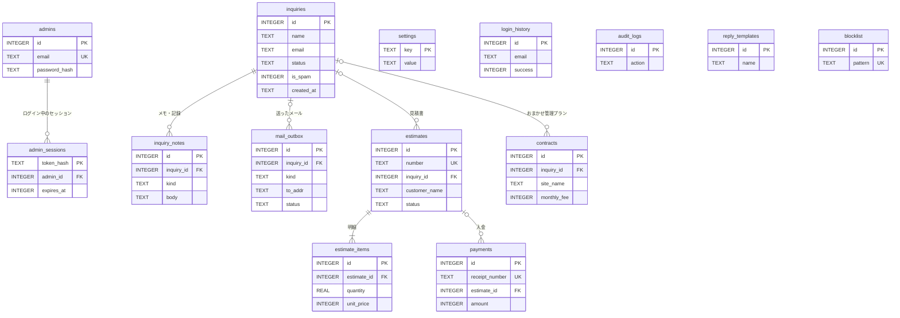

# 05 データベース設計

## 1. 概要

| 項目 | 内容 |
| --- | --- |
| 種類 | SQLite（Python 標準の `sqlite3`） |
| ファイル | `data/app.db`（`.env` の `DATABASE_PATH` で変更できる。相対パスはプロジェクトのルートから） |
| 接続 | API のリクエストごとに開いて閉じる。待ち時間 10秒、外部キーの制約を有効（`PRAGMA foreign_keys = ON`）、行は列名で読める形（`sqlite3.Row`） |
| 表の作成・変更 | API の起動時に、足りない表・列を順番に追加する（8章） |
| 入力の長さ | 表の定義では長さを決めず、API の入力チェックで制限する（下の表の「API の制限」） |

## 2. ER 図

`settings`・`login_history`・`audit_logs`・`reply_templates`・`blocklist` は、ほかの表とつながりません。

## 3. テーブル一覧

| No. | テーブル | 内容 | 追加した版（8章） |
| --- | --- | --- | --- |
| 1 | `inquiries` | お問い合わせ | 1（`is_spam` は 2） |
| 2 | `admins` | 管理者（1人だけ） | 1 |
| 3 | `admin_sessions` | ログイン中のセッション | 1 |
| 4 | `inquiry_notes` | お問い合わせのメモ・記録（タイムライン） | 2 |
| 5 | `settings` | 管理画面から変える設定（値は JSON） | 2 |
| 6 | `login_history` | ログイン履歴 | 2 |
| 7 | `audit_logs` | 操作の記録 | 2 |
| 8 | `mail_outbox` | 送信履歴 | 2（`reply_to` は 3） |
| 9 | `reply_templates` | 返信テンプレート | 2 |
| 10 | `blocklist` | ブロックリスト | 2 |
| 11 | `estimates` | 見積書 | 2 |
| 12 | `estimate_items` | 見積書の明細 | 2 |
| 13 | `payments` | 入金（領収書） | 2 |
| 14 | `contracts` | おまかせ管理プラン | 2 |

## 4. テーブル定義

列の「NULL」は、○ が NULL を入れられる列です。`id` はすべて `INTEGER PRIMARY KEY AUTOINCREMENT`（自動の連番）です。日時（`*_at`）は UTC の `YYYY-MM-DDTHH:MM:SSZ`、日付は `YYYY-MM-DD` の文字列です。

### 4.1 inquiries（お問い合わせ）

| 列 | 型 | NULL | 初期値 | 内容 | API の制限・備考 |
| --- | --- | --- | --- | --- | --- |
| id | INTEGER | | 連番 | 主キー | |
| topics | TEXT | | | ご相談内容の値の JSON 配列（例 `["python_react_fastapi"]`） | 選択肢の値だけ・1つ以上 |
| name | TEXT | | | お名前 | 100文字 |
| email | TEXT | | | メールアドレス | 254文字・半角 |
| phone | TEXT | | | 電話番号（数字のみ・ハイフンなし） | 10〜11桁 |
| prefecture | TEXT | | | お住まい（都道府県名） | |
| age | INTEGER | ○ | | ご年齢 | 1〜120 |
| initial_payment | TEXT | | | 初期費用のお支払い方法の値 | |
| monthly_payment | TEXT | | | 月額のお支払い方法の値 | |
| status | TEXT | | `'new'` | 対応状況の値 | |
| created_at | TEXT | | | 受付日時 | |
| updated_at | TEXT | | | 最終更新（対応状況・迷惑送信の変更、メモ・記録の追加で更新） | 自動削除の期間の数え始め |
| is_spam | INTEGER | | `0` | 迷惑送信なら 1 | |

インデックス: `idx_inquiries_created_at`（created_at）、`idx_inquiries_status`（is_spam, status）

### 4.2 admins（管理者）

| 列 | 型 | NULL | 初期値 | 内容 | 備考 |
| --- | --- | --- | --- | --- | --- |
| id | INTEGER | | 連番 | 主キー | |
| email | TEXT | | | メールアドレス（小文字） | 一意。`.env` の `ADMIN_EMAIL` |
| password_hash | TEXT | | | パスワードのハッシュ（`pbkdf2_sha256$回数$ソルト$ハッシュ`） | [07](07_セキュリティ設計.md) 2章 |
| created_at / updated_at | TEXT | | | 作成日時 / 更新日時 | |

起動時に、`.env` の管理者以外の行は削除します（いつも1行だけ）。

### 4.3 admin_sessions（ログイン中のセッション）

| 列 | 型 | NULL | 初期値 | 内容 | 備考 |
| --- | --- | --- | --- | --- | --- |
| token_hash | TEXT | | | Cookie のトークンの SHA-256（16進数） | 主キー。トークンそのものは保存しない |
| admin_id | INTEGER | | | 管理者の ID | 外部キー → admins（削除時 CASCADE） |
| expires_at | INTEGER | | | 有効期限（UNIX 秒） | 作成から12時間 |
| created_at | TEXT | | | 作成日時 | |

### 4.4 inquiry_notes（メモ・記録）

| 列 | 型 | NULL | 初期値 | 内容 | 備考 |
| --- | --- | --- | --- | --- | --- |
| id | INTEGER | | 連番 | 主キー | |
| inquiry_id | INTEGER | | | お問い合わせの ID | 外部キー → inquiries（削除時 CASCADE） |
| kind | TEXT | | `'note'` | `note` 手入力のメモ / `email` 返信したメール / `system` 自動の記録 | |
| body | TEXT | | | 本文 | メモは5000文字 |
| created_at | TEXT | | | 作成日時 | |

インデックス: `idx_inquiry_notes_inquiry`（inquiry_id）

### 4.5 settings（設定）

| 列 | 型 | NULL | 初期値 | 内容 |
| --- | --- | --- | --- | --- |
| key | TEXT | | | 設定のキー（主キー。7章） |
| value | TEXT | | | 値（JSON。日本語はそのまま） |
| updated_at | TEXT | | | 更新日時 |

### 4.6 login_history（ログイン履歴）

| 列 | 型 | NULL | 初期値 | 内容 | 備考 |
| --- | --- | --- | --- | --- | --- |
| id | INTEGER | | 連番 | 主キー | |
| email | TEXT | | | 入力されたメールアドレス（小文字） | 254文字で切る |
| success | INTEGER | | | 成功なら 1、失敗なら 0 | |
| ip | TEXT | | `''` | 接続元の IP アドレス | 64文字で切る |
| user_agent | TEXT | | `''` | ブラウザの情報 | 300文字で切る |
| created_at | TEXT | | | 日時 | |

### 4.7 audit_logs（操作の記録）

| 列 | 型 | NULL | 初期値 | 内容 | 備考 |
| --- | --- | --- | --- | --- | --- |
| id | INTEGER | | 連番 | 主キー | |
| action | TEXT | | | 操作（例「対応状況を変更」） | [06](06_処理設計.md) 21章 |
| detail | TEXT | | `''` | 内容 | 1000文字で切る |
| created_at | TEXT | | | 日時 | |

### 4.8 mail_outbox（送信履歴）

| 列 | 型 | NULL | 初期値 | 内容 | 備考 |
| --- | --- | --- | --- | --- | --- |
| id | INTEGER | | 連番 | 主キー | |
| inquiry_id | INTEGER | ○ | | 関係するお問い合わせの ID（テストメールは NULL） | 外部キー → inquiries。仕様: お問い合わせを削除したら、この行も削除する（※課題 No.1: 今は削除時 SET NULL で行が残る） |
| kind | TEXT | | | `admin_notify` 新着通知 / `auto_reply` 自動返信 / `reply` 返信 / `test` テスト | |
| to_addr | TEXT | | | 宛先 | |
| subject | TEXT | | | 件名 | |
| body | TEXT | | | 本文 | 新着通知・自動返信には、お問い合わせの内容が入る |
| status | TEXT | | | `pending` 送信中 / `sent` 送信済み / `failed` 失敗 / `skipped` 未送信 | 状態の変わり方は [06](06_処理設計.md) 4.1 |
| error | TEXT | | `''` | 送れなかった理由 | |
| created_at | TEXT | | | 登録日時 | |
| sent_at | TEXT | ○ | | 送信した日時（送信済みのときだけ） | |
| reply_to | TEXT | | `''` | 返信先（Reply-To）。新着通知ではお客さまのメールアドレス | |

### 4.9 reply_templates（返信テンプレート）

| 列 | 型 | NULL | 初期値 | 内容 | API の制限 |
| --- | --- | --- | --- | --- | --- |
| id | INTEGER | | 連番 | 主キー | |
| name | TEXT | | | テンプレート名 | 60文字 |
| subject | TEXT | | | 件名（差し込み項目を使える） | 200文字 |
| body | TEXT | | | 本文（差し込み項目を使える） | 20000文字 |
| created_at / updated_at | TEXT | | | 作成日時 / 更新日時 | |

初期データ（版 2 で追加）: 「お問い合わせのお礼（ご相談の日程調整）」、「お見積りのご案内」の2件。

### 4.10 blocklist（ブロックリスト）

| 列 | 型 | NULL | 初期値 | 内容 | API の制限 |
| --- | --- | --- | --- | --- | --- |
| id | INTEGER | | 連番 | 主キー | |
| pattern | TEXT | | | メールアドレス、または `@ドメイン`（小文字） | 一意・3〜254文字 |
| note | TEXT | | `''` | メモ | 200文字 |
| created_at | TEXT | | | 登録日時 | |

### 4.11 estimates（見積書）

| 列 | 型 | NULL | 初期値 | 内容 | API の制限・備考 |
| --- | --- | --- | --- | --- | --- |
| id | INTEGER | | 連番 | 主キー | |
| number | TEXT | | | 見積番号 `YYYY-MMDD-NNN-HHMM`（以前に作ったものは `Q-YYYYMM-NNN` のまま） | 一意。作成時に採番し、変えない |
| inquiry_id | INTEGER | ○ | | 関連するお問い合わせ | 外部キー → inquiries（削除時 SET NULL） |
| customer_name | TEXT | | | お客さま名（様・御中は付けない） | 100文字 |
| honorific | TEXT | | `'様'` | 宛名の敬称 `様` / `御中` | 版 5 で追加 |
| title | TEXT | | | 件名 | 120文字 |
| issue_date | TEXT | | | 発行日 | |
| valid_until | TEXT | | | 有効期限 | 発行日以降 |
| delivery | TEXT | | `''` | 納期 | 200文字 |
| payment_terms | TEXT | | `''` | お支払い条件 | 200文字 |
| notes | TEXT | | `''` | 備考 | 2000文字 |
| tax_rate | INTEGER | | `10` | 消費税率（%） | 0〜100 |
| status | TEXT | | `'draft'` | `draft` 下書き / `sent` 送付済み / `accepted` 承諾 / `rejected` 不成立 | |
| created_at / updated_at | TEXT | | | 作成日時 / 更新日時 | |

小計・消費税・合計・入金済み・残額は保存せず、読むたびに明細と入金から計算します（[06](06_処理設計.md) 13章）。

### 4.12 estimate_items（見積書の明細）

| 列 | 型 | NULL | 初期値 | 内容 | API の制限 |
| --- | --- | --- | --- | --- | --- |
| id | INTEGER | | 連番 | 主キー | |
| estimate_id | INTEGER | | | 見積書の ID | 外部キー → estimates（削除時 CASCADE） |
| description | TEXT | | | 内容 | 200文字 |
| quantity | REAL | | | 数量 | 0 より大きく 100000 以下 |
| unit | TEXT | | `'式'` | 単位 | 10文字 |
| unit_price | INTEGER | | | 単価（円・税抜） | 0〜100,000,000 |
| sort_order | INTEGER | | | 並び順（0から） | |

見積書を保存するたびに、その見積書の明細をすべて削除して入れ直します。

### 4.13 payments（入金）

| 列 | 型 | NULL | 初期値 | 内容 | API の制限・備考 |
| --- | --- | --- | --- | --- | --- |
| id | INTEGER | | 連番 | 主キー | |
| receipt_number | TEXT | | | 領収書番号 `YYYY-MMDD-NNN-HHMM`（以前に作ったものは `R-YYYYMM-NNN` のまま） | 一意。作成時に採番し、変えない |
| estimate_id | INTEGER | ○ | | 関連する見積書 | 外部キー → estimates（削除時 SET NULL） |
| customer_name | TEXT | | | お客さま名 | 100文字 |
| description | TEXT | | | 但し書き | 200文字 |
| amount | INTEGER | | | 金額（円・税込） | 1〜1,000,000,000 |
| method | TEXT | | | `cash` 現金（手渡し）/ `card` クレジットカード / `bank` 銀行振込 | |
| paid_on | TEXT | | | 入金日 | |
| note | TEXT | | `''` | メモ（領収書に印刷しない） | 1000文字 |
| created_at / updated_at | TEXT | | | 作成日時 / 更新日時 | |

領収書の発行日は、印刷し直しても変わらないように持ちます（※課題 No.2: 今は列がなく、印刷画面を開いた日を表示している）。

### 4.14 contracts（おまかせ管理プラン）

| 列 | 型 | NULL | 初期値 | 内容 | API の制限・備考 |
| --- | --- | --- | --- | --- | --- |
| id | INTEGER | | 連番 | 主キー | |
| inquiry_id | INTEGER | ○ | | 関連するお問い合わせ | 外部キー → inquiries（削除時 SET NULL） |
| customer_name | TEXT | | | お客さま名 | 100文字 |
| email | TEXT | | `''` | メールアドレス | 254文字 |
| site_name | TEXT | | | サイト名 | 100文字 |
| site_url | TEXT | | `''` | サイトの URL | 300文字 |
| monthly_fee | INTEGER | | | 月額（円・税込） | 0〜10,000,000 |
| start_date | TEXT | | | 開始日 | |
| cancel_requested_on | TEXT | ○ | | 解約の申し出日 | |
| end_date | TEXT | ○ | | 終了日 | 開始日以降 |
| note | TEXT | | `''` | メモ | 1000文字 |
| created_at / updated_at | TEXT | | | 作成日時 / 更新日時 | |

状態（契約中・解約予定・終了）は保存せず、読むたびに日付から判定します（[06](06_処理設計.md) 15章）。

## 5. 外部キーと、削除したときの動き

| 削除するもの | つながっている表 | 動き |
| --- | --- | --- |
| 管理者（admins） | admin_sessions | 一緒に削除（CASCADE） |
| お問い合わせ（inquiries） | inquiry_notes | 一緒に削除（CASCADE） |
| 〃 | mail_outbox | **仕様: 一緒に削除**（※課題 No.1: 今は SET NULL で、行が残りひもづけだけ外れる） |
| 〃 | estimates・contracts | 行は残し、ひもづけだけ外す（SET NULL）。見積書・契約はお金の記録なので残す |
| 見積書（estimates） | estimate_items | 一緒に削除（CASCADE） |
| 〃 | payments | 行は残し、ひもづけだけ外す（SET NULL） |

## 6. コード値

| 表.列 | 値 | 表示 | 定義している場所 |
| --- | --- | --- | --- |
| inquiries.status | `new` / `in_progress` / `quoted` / `contracted` / `done` / `declined` | 未対応 / 対応中 / 見積送付済み / 契約済み / 対応済み / お断り | `shared/contact_options.json`（statuses） |
| inquiries.topics | `python_react_fastapi` | Python(React/FastAPI) | 同上（topics） |
| inquiries.initial_payment | `cash` / `card` | 手渡し / クレジットカード | 同上（initial_payments） |
| inquiries.monthly_payment | `card_auto` / `none` | クレジットカードの自動決済 / おまかせ管理プランなし | 同上（monthly_payments） |
| inquiries.prefecture | 47都道府県の名前 | そのまま | 同上（prefectures） |
| inquiry_notes.kind | `note` / `email` / `system` | メモ / メール / 記録 | `inquiries.py`・画面 |
| mail_outbox.kind | `admin_notify` / `auto_reply` / `reply` / `test` | 新着通知 / 自動返信 / 返信 / テスト | `mailer.py`・`lib/options.ts` |
| mail_outbox.status | `pending` / `sent` / `failed` / `skipped` | 送信中 / 送信済み / 失敗 / 未送信 | 同上 |
| estimates.status | `draft` / `sent` / `accepted` / `rejected` | 下書き / 送付済み / 承諾 / 不成立 | `billing.py`・`lib/options.ts` |
| payments.method | `cash` / `card` / `bank` | 現金（手渡し）/ クレジットカード / 銀行振込 | 同上 |
| おまかせ管理プランの状態（計算） | `active` / `cancel_requested` / `ended` | 契約中 / 解約予定 / 終了 | 同上 |

`shared/contact_options.json` の値（value）を変えると、保存済みのデータとラベルが合わなくなります。値を変えるときは、マイグレーションで保存済みのデータも置き換えます（版 4 が例）。

## 7. settings のキー

| キー | 値（JSON） | 初期値（保存がないとき） | 変える画面 |
| --- | --- | --- | --- |
| `theme` | `{"primary_color": "#rrggbb"}` | `shared/site_defaults.json` の theme（`#1558c0`） | A-12 |
| `smtp` | `{"host", "port", "security", "username", "password", "from_address", "from_name"}` | `{"host": "", "port": 587, "security": "starttls", "username": "", "password": "", "from_address": "", "from_name": 初期の屋号}` | A-13 |
| `notifications` | `{"admin_notify", "admin_to", "auto_reply", "auto_reply_subject", "auto_reply_body", "site_url"}` | 新着通知 あり・送り先 空（= 事業者のメール）・自動返信 あり・件名「【{business_name}】お問い合わせを受け付けました」・本文（`settings_store.py` の `DEFAULT_AUTO_REPLY_BODY`）・`site_url` は `http://127.0.0.1:5173` | A-13 |
| `retention` | `{"enabled", "months", "statuses", "spam_days"}` | `{"enabled": false, "months": 24, "statuses": ["done", "declined"], "spam_days": 30}` | A-16 |
| `retention.last_run` | `{"at": 日時, "deleted": 件数}` | なし | 自動削除の実行時 |
| `mail.method` | `"outlook"` / `"smtp"` | なし（`.env` に `MICROSOFT_CLIENT_ID` があれば outlook、なければ smtp とみなす） | A-13 |
| `admin.env_password_hash` | `.env` のパスワードのハッシュ（文字列） | なし | 起動時（[06](06_処理設計.md) 6.5） |
| `content.business` など6つ | サイト内容の各項目（[04](04_API設計.md) の SiteContent） | `shared/site_defaults.json` の同じ項目 | A-11 |

読み出すときの決まり（`settings_store.py`）:

- `theme`・`smtp`・`notifications`・`retention` は、初期値に保存した値を上書きして返します。初期値にないキーは捨てます（項目を追加したときも、保存済みの設定がそのまま使えます）。
- `content.*` は、保存した値をそのまま返します。保存がなければ初期値です。「初期値に戻す」は、この行を削除します。

## 8. マイグレーション（表の作成・変更）

`db.py` の `MIGRATIONS`（SQL のリスト）を、起動時に順番に実行します。どこまで実行したかは `PRAGMA user_version` に記録し、まだ実行していない版だけを実行します（保存済みのデータは残ります）。

| 版 | 内容 |
| --- | --- |
| 1 | 最初の構成。`inquiries`、`admins`、`admin_sessions`、`idx_inquiries_created_at` |
| 2 | `inquiries.is_spam` と `idx_inquiries_status`、`inquiry_notes`、`settings`、`login_history`、`audit_logs`、`mail_outbox`、`reply_templates`（初期データ2件）、`blocklist`、`estimates`、`estimate_items`、`payments`、`contracts` |
| 3 | `mail_outbox.reply_to`（新着通知に返信すると、お客さまあてになるように） |
| 4 | ご相談内容の選択肢の値を変更し、保存済みのお問い合わせも新しい値に置き換え |
| 5 | `estimates.honorific`（敬称）と `estimates.delivery_place`（納品場所） |
| 6 | `estimates.delivery_place` を削除（見積書に納品場所を出すのをやめたため） |

追加するときの決まり:

- リストの**最後に**追加します。順番を変えたり、実行済みの版を書き換えたりしません。
- 2つ以上の文があるときは `BEGIN;` 〜 `COMMIT;` で囲みます（途中で失敗したときに半分だけ変わらないように）。

## 9. ファイルに保存するデータ

| ファイル | 内容 | 備考 |
| --- | --- | --- |
| `data/uploads/{16進数24桁}.{png・jpg・gif・webp}` | 管理画面でアップロードした画像 | 名前はランダム。サイト内容から使われなくなっても自動では消さない |
| `data/microsoft-oauth.json` | Outlook のトークン `{"access_token", "refresh_token", "expires_at"（UNIX 秒）}` | 権限 600。git 管理外。サインインの解除で削除 |
| `.env` | API の設定（管理者のパスワードなど） | 権限 600（作成時）。git 管理外（[08](08_設定と運用.md)） |
