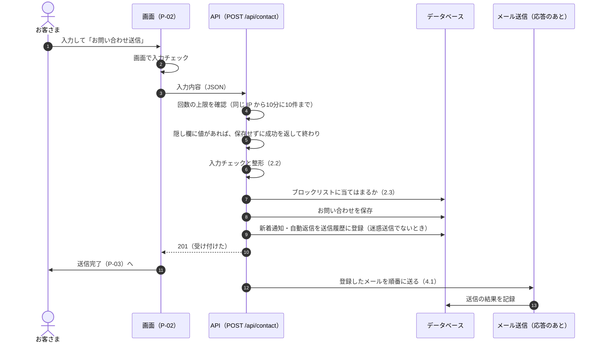
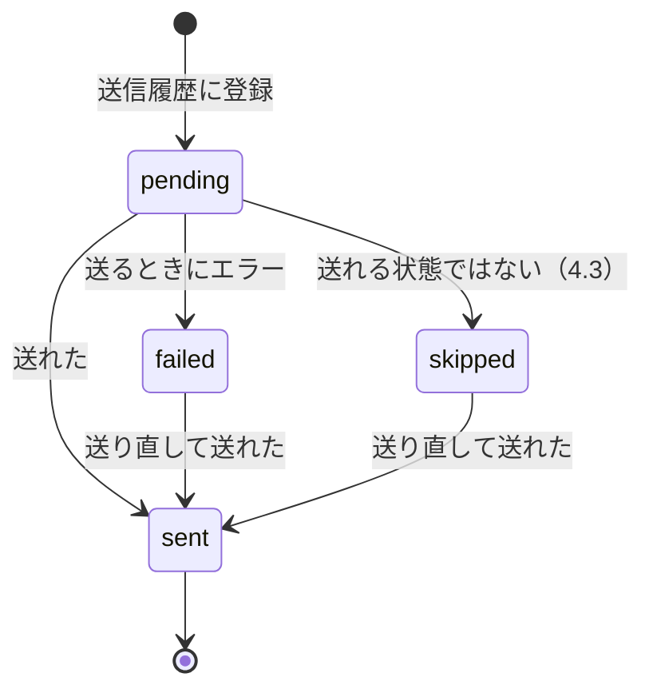
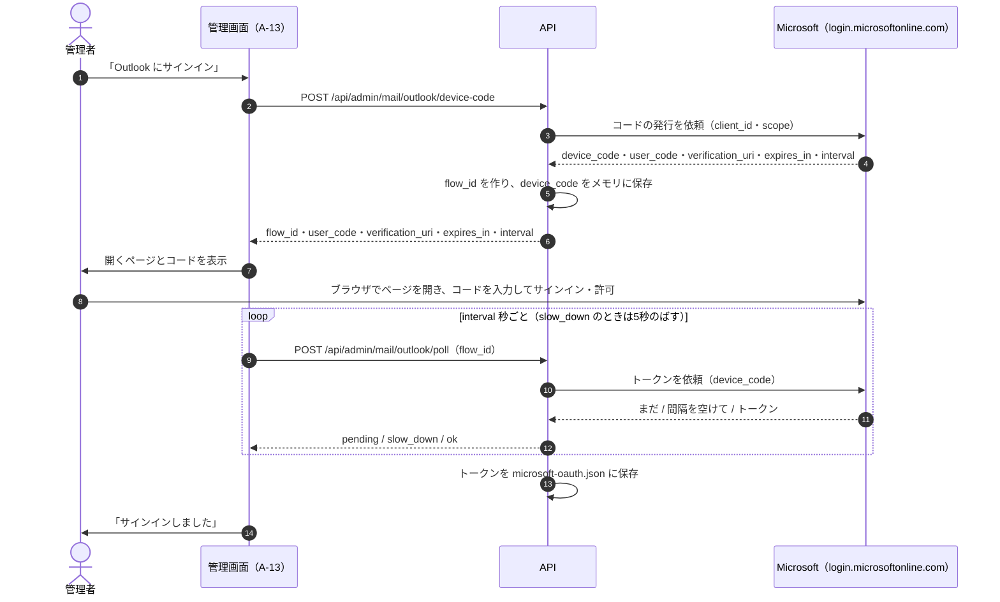
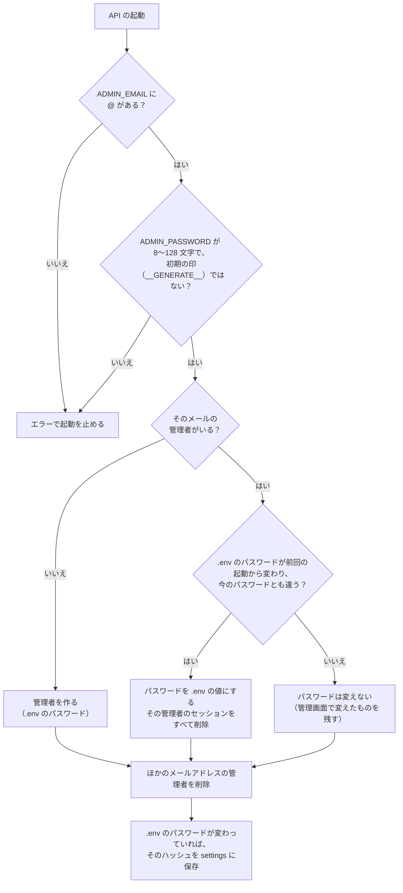
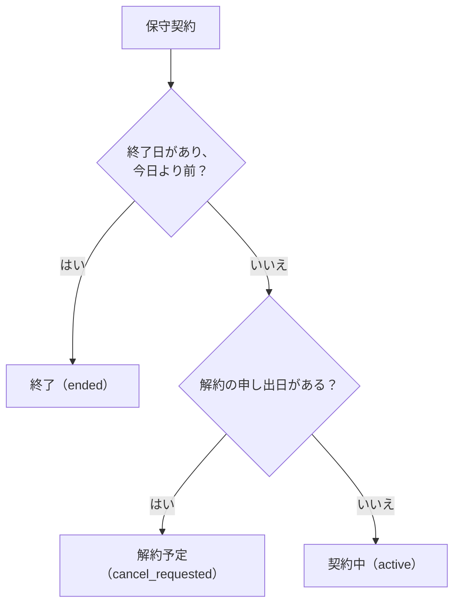

# 06 処理設計

画面・API の中で行う処理の決まりです。API の入出力は [04 API 設計](04_API設計.md)、表の定義は [05 データベース設計](05_DB設計.md) を見てください。

## 1. 起動と終了の処理（`main.py`）

API を起動したときに、次の順番で準備します。

1. 設定を読む（`.env`、`shared/contact_options.json`、`shared/site_defaults.json`）。OS の環境変数があれば `.env` より優先します。
2. `data` フォルダがなければ作り、マイグレーションで表・列をそろえる（[05](05_DB設計.md) 8章）。
3. `.env` の管理者を反映する（6.5）。設定が正しくなければ、エラーで起動を止めます。
4. 期限切れのセッションを削除する。
5. 自動削除の定期処理を始める（11章）。起動の10秒後に1回目、その後は24時間ごと。定期処理でエラーが起きても、ログに残すだけで API は止めません。

API を止めるときは、定期処理を止めてから終わります。

## 2. お問い合わせの受付（API-03）

### 2.1 処理の流れ



- **隠し欄**（`website`）は、人には見えない入力欄です。値が入っているのは機械的な送信なので、保存もメール送信もせず、成功したように返します（送った側に見破られないため）。
- ブロックリストに当てはまるときは、**迷惑送信として保存**し、メールは送りません（管理画面の迷惑送信の一覧で確認できる）。
- メールは応答を返したあとで送るので、メールサーバーが遅くても、お客さまを待たせません。

### 2.2 入力チェックと整形（`inquiries.validate_contact`）

すべての項目をチェックして、エラーをまとめて返します。画面（P-02）も同じルールで先にチェックします。

| 項目 | 整形 | チェック | エラー文 |
| --- | --- | --- | --- |
| topics | 配列の中の文字列のうち、選択肢にある値だけを、重複なしで残す（配列でなければ空） | 1つ以上 | ご相談内容を選択してください。 |
| name | 前後の空白を除く | 空でない・100文字以内 | お名前を入力してください。/ お名前は100文字以内で入力してください。 |
| email | 全角の英数字・記号・空白を半角にし、前後の空白を除く | 空でない・254文字以内・`^[^\s@]+@[^\s@]+\.[^\s@]+$` | メールアドレスを入力してください。/ メールアドレスの形式が正しくありません。 |
| phone | 半角にし、空白・ハイフン類（`-` `‐` `‑` `‒` `–` `—` `―` `−`）・長音（`ー` `ｰ`）・かっこを除く | 入力が空でない・`^0[0-9]{9,10}$` | 電話番号を入力してください。/ 電話番号の形式が正しくありません（例:09012345678）。 |
| prefecture | 前後の空白を除く | 47都道府県のどれか | お住まいを選択してください。 |
| age | 半角にし、前後の空白を除く。空なら NULL | 半角の数字だけ・1〜120 | ご年齢は数字で入力してください。/ ご年齢は1〜120の範囲で入力してください。 |
| initial_payment | 前後の空白を除く | 選択肢の値 | 初期費用のお支払い方法を選択してください。 |
| monthly_payment | 前後の空白を除く | 選択肢の値 | 月額(保守プラン)のお支払い方法を選択してください。 |
| agreed | − | 真偽の `true`（文字列の `"true"` は不可） | 「個人情報の取扱い」への同意が必要です。 |

- 文字列の項目に数値が送られたときは文字列に直します。真偽・null・配列・オブジェクトは空として扱います。
- 全角から半角への変換は、`！`〜`～`（U+FF01〜U+FF5E）を対応する半角に、全角の空白（U+3000）を半角の空白にします。

### 2.3 迷惑送信の判定（`inquiries.is_blocked`）

メールアドレスを小文字にし、ブロックリストの各行と比べます。

| パターン | 当てはまる条件 | 例 |
| --- | --- | --- |
| メールアドレス | 完全に同じ | `spam@example.com` |
| `@ドメイン` | メールアドレスの最後が `@ドメイン` | `@example.com` は `a@example.com` に当てはまり、`a@sub.example.com` には当てはまらない |

## 3. お問い合わせの一覧・検索（API-10・API-11）

| 条件 | SQL の条件 |
| --- | --- |
| 迷惑送信 | `is_spam = 1`（迷惑送信の一覧）/ `is_spam = 0`（それ以外） |
| 対応状況 | `status = ?` |
| キーワード | お名前・メール（どちらも小文字にして比べる）・電話番号のどれかに含まれる。`instr` で探すので、`%` や `_` も普通の文字として扱う |
| 受付日（から） | `created_at >=`（その日の日本時間 0:00 を UTC にした日時） |
| 受付日（まで） | `created_at <`（その翌日の日本時間 0:00 を UTC にした日時） |

| 並び順 | ORDER BY |
| --- | --- |
| `newest`（新しい順・初期） | `created_at DESC, id DESC` |
| `oldest`（古い順） | `created_at ASC, id ASC` |
| `name`（名前順） | `name COLLATE NOCASE ASC, id DESC` |
| `updated`（更新が新しい順） | `updated_at DESC, id DESC` |

ページ分けは、同じ条件の件数（`COUNT(*)`）と `LIMIT 20 OFFSET (ページ − 1) × 20` で取ります。CSV は同じ条件・同じ並び順で、すべての行を取ります。

## 4. メール送信（`mailer.py`）

### 4.1 送信の流れと、送信履歴の状態

すべてのメールは、まず送信履歴（`mail_outbox`）に「送信中」で登録してから送り、結果をその行に記録します。



| 状態 | 表示 | 意味 | 記録すること |
| --- | --- | --- | --- |
| `pending` | 送信中 | 登録して、まだ結果が出ていない | |
| `sent` | 送信済み | 送れた | `sent_at` に送った日時 |
| `failed` | 失敗 | メールサーバーや Microsoft がエラーを返した・つながらない | `error` に理由 |
| `skipped` | 未送信 | 送信方法の設定やサインインがまだで、送らなかった | `error` に理由（4.3） |

- 送り直し（API-45）で、もう一度失敗したときは「失敗」「未送信」のまま、理由を書き換えます。
- 送るタイミング: 新着通知・自動返信は、お問い合わせの応答のあとで、登録した順に送ります。返信・テスト・送り直しは、その場で送り、結果を応答で返します。
- API が送信の途中で止まると、その行は「送信中」のまま残ります（※課題 No.5）。

### 4.2 送信方法の決め方

1. `settings` の `mail.method` が `outlook` か `smtp` なら、それを使う。
2. 保存されていなければ、`.env` に `MICROSOFT_CLIENT_ID` があれば `outlook`、なければ `smtp`。

### 4.3 送れる状態かの判定

| 送信方法 | 送れない条件 | 理由（`error` と画面に出る文） |
| --- | --- | --- |
| outlook | `.env` に `MICROSOFT_CLIENT_ID` がない | .env の MICROSOFT_CLIENT_ID が設定されていないため、Outlook で送れません。 |
| outlook | トークンのファイル（`data/microsoft-oauth.json`）がない | Outlook にまだサインインしていないため、送信していません。管理画面の「メール」でサインインしてください。 |
| smtp | SMTP のサーバー名か送信元のアドレスがない | メールの送信設定（SMTP）がされていないため、送信していません。 |

### 4.4 差出人

| 送信方法 | 差出人名 | 送信元のアドレス |
| --- | --- | --- |
| outlook | `.env` の `MAIL_FROM_NAME`、なければ屋号 | `.env` の `MAIL_FROM_ADDRESS`、なければ事業者情報のメール |
| smtp | SMTP の設定の差出人名、なければ屋号 | SMTP の設定の送信元のアドレス |

Outlook では、サインインした Outlook アカウントから送られます。送信元のアドレスは、そのアカウントと同じにします。

### 4.5 メールの組み立て（`build_message`）

| ヘッダー・本文 | 内容 |
| --- | --- |
| To | 宛先。形式に合わなければ送らずに「送信先のメールアドレスが正しくありません: {宛先}」（失敗） |
| Subject | 件名。改行や続いた空白は、1つの空白にする（ヘッダーに改行を入れさせない） |
| From | 差出人名（同じく1行にする）と送信元のアドレス |
| Reply-To | 返信先。メールの形式に合うときだけ付ける（新着通知だけ） |
| Message-ID | 送信元のアドレスのドメインで作る |
| 本文 | テキスト（UTF-8） |

### 4.6 SMTP での送信

| 接続方式（security） | 接続のしかた | ポートが空のとき |
| --- | --- | --- |
| `ssl` | 最初から暗号化して接続（SMTP over SSL/TLS） | 465 |
| `starttls`（初期） | 接続してから STARTTLS で暗号化 | 587 |
| `none` | 暗号化しない | 587 |

- 待ち時間は20秒。暗号化するときは、サーバーの証明書を確認します。
- ユーザー名が入っていればログインします。

| エラー | 理由の文 |
| --- | --- |
| 認証の失敗 | メールサーバーの認証に失敗しました。ユーザー名とパスワードを確認してください。 |
| STARTTLS に対応していない | メールサーバーが暗号化（STARTTLS）に対応していません。接続方式を確認してください。 |
| 時間切れ | メールサーバーへの接続がタイムアウトしました。サーバー名とポートを確認してください。 |
| そのほか（つながらないなど） | メールを送信できませんでした（{エラーの種類}: {内容}）。 |

### 4.7 Outlook（Microsoft Graph）での送信（`outlook.py`）

1. アクセストークンを用意する。保存したトークンの期限まで60秒より長く残っていれば、そのまま使う。残りが短ければ、リフレッシュトークンで新しいトークンをもらい、ファイルに保存する（新しいリフレッシュトークンが返らなければ、今のものを使い続ける）。
2. `POST {Graph}/v1.0/me/sendMail` に、4.5 で組み立てたメール（MIME 形式）を Base64 にして送る（`Content-Type: text/plain`、`Authorization: Bearer {トークン}`）。件名・本文・返信先が、そのまま届きます。
3. 待ち時間は30秒。

| エラー | 理由の文 |
| --- | --- |
| サインインしていない | Outlook にまだサインインしていません。管理画面の「メール」でサインインしてください。 |
| トークンのファイルが読めない | 保存したサインイン情報を読み込めませんでした。サインインし直してください。 |
| トークンの更新に失敗 | Outlook の認証を更新できませんでした。管理画面の「メール」でサインインし直してください。（{理由}） |
| 送信のエラー | Outlook での送信に失敗しました。（{コード} {Microsoft の応答の先頭300文字}） |
| つながらない | Outlook（Microsoft Graph）に接続できませんでした（{内容}）。 |

トークンの読み出しと更新は、同時に2つ動かないように鍵（ロック）をかけます。Outlook.com は SMTP のパスワード認証を廃止しているため、この方法を標準にしています。

### 4.8 新着通知と自動返信（`queue_new_inquiry_mails`）

| メール | 送る条件 | 宛先 | 件名 | 返信先 |
| --- | --- | --- | --- | --- |
| 新着通知（`admin_notify`） | 設定「お問い合わせが届いたら、メールで知らせる」がオン | 設定の送り先（1人ずつ別の送信履歴）。空なら事業者情報のメール | 【お問い合わせ】{お名前} 様 | お客さまのメールアドレス |
| 自動返信（`auto_reply`） | 設定「お客さまにメールで知らせる」がオン | お客さまのメールアドレス | 設定の件名（差し込み項目を置き換える） | なし |

新着通知の本文:

```
お問い合わせフォームから、新しいお問い合わせが届きました。
このメールに返信すると、お客さまのメールアドレス宛てに送られます。

■ ご相談内容
Python(React/FastAPI)

■ お名前
山田 太郎

■ メールアドレス
taro@example.com

■ 電話番号
09012345678

■ お住まい
兵庫県

■ ご年齢
30            ← 未入力なら「(未入力)」

■ 初期費用のお支払い方法
手渡し

■ 月額(保守プラン)のお支払い方法
保守プランなし

■ 受付日時
2026年10月30日 14:05     ← 日本時間

管理画面で確認する: {サイトの URL}/admin/inquiries/{ID}
```

自動返信の本文の初期値（`settings_store.py` の `DEFAULT_AUTO_REPLY_BODY`）:

```
{name} 様

{business_name}です。
このたびはお問い合わせいただき、ありがとうございます。
以下の内容で受け付けました。内容を確認して、ご連絡いたします。

{inquiry_summary}

※ このメールは自動でお送りしています。
※ お心当たりのない場合は、お手数ですがこのメールを破棄してください。

――――――――――――――――
{business_name}
メール: {business_email}
電話: {business_phone}
対応時間: {hours}
```

件名の初期値は「【{business_name}】お問い合わせを受け付けました」です。

### 4.9 差し込み項目

`{項目名}` を、送るときに次の値に置き換えます。知らない項目は、そのまま残します。

| 項目 | 値 | 使えるところ |
| --- | --- | --- |
| `{name}` | お客さまのお名前 | 自動返信・返信テンプレート |
| `{business_name}` | 屋号 | 同上 |
| `{owner}` | 運営責任者 | 同上 |
| `{business_email}` | 事業者のメールアドレス | 同上 |
| `{business_phone}` | 事業者の電話番号 | 同上 |
| `{hours}` | 対応時間 | 同上 |
| `{inquiry_summary}` | お問い合わせの内容（下の形） | 自動返信だけ |

```
ご相談内容: Python(React/FastAPI)
お名前: 山田 太郎
メールアドレス: taro@example.com
電話番号: 09012345678
お住まい: 兵庫県
ご年齢: 30            ← 未入力なら「未入力」
初期費用のお支払い方法: 手渡し
月額(保守プラン)のお支払い方法: 保守プランなし
```

- 自動返信は API で置き換えます（`mailer.render`）。
- 返信テンプレートは、管理画面（A-04）でテンプレートを選んだときに画面で置き換え、管理者が直してから送ります。
- 事業者の情報は、サイト内容の事業者情報です。

### 4.10 管理画面からの返信（API-17）

1. 送信履歴に「返信」として登録し、その場で送る。
2. 送れたときだけ、お問い合わせの記録（種類「メール」）に件名と本文を残し、未対応なら対応中に変える。
3. 送れなかったときは、エラーを返す。送信履歴には「失敗」「未送信」で残り、送信履歴から送り直せる（※課題 No.6: 送り直しで送れても、2 の記録・対応状況の変更は行われない）。

## 5. Outlook のサインイン（デバイスコード）

管理者の Outlook アカウントで1回だけサインインし、そのトークンでメールを送ります。OAuth 2.0 のデバイス認可フローを使います。



| 項目 | 内容 |
| --- | --- |
| Azure のアプリ | `.env` の `MICROSOFT_CLIENT_ID`。クライアントシークレットは使わない |
| テナント | `.env` の `MICROSOFT_TENANT`（初期値 `consumers` = 個人の Microsoft アカウント） |
| 権限（scope） | `offline_access https://graph.microsoft.com/Mail.Send` |
| 接続先 | `https://login.microsoftonline.com/{テナント}/oauth2/v2.0/devicecode`・`/token`。テストでは環境変数 `MICROSOFT_LOGIN_URL`・`MICROSOFT_GRAPH_URL` で偽のサーバーに向ける |
| 途中の情報 | `flow_id`（ランダム）ごとに `device_code` と期限を、API のメモリに持つ。`device_code` は画面に渡さない。完了・エラーで捨て、期限切れのものは次にコードを発行するときに捨てる |
| トークンの保存 | `{"access_token", "refresh_token", "expires_at"}` を、権限 600 の一時ファイル（`.tmp`）に書いてから置き換える（書きかけのファイルを残さない） |
| サインインの解除 | トークンのファイルを削除する |

確認（poll）の結果:

| Microsoft の応答 | API の結果 |
| --- | --- |
| トークンが返った | `ok`（トークンを保存） |
| `authorization_pending` | `pending` |
| `slow_down` | `slow_down` |
| `expired_token` | エラー「サインインの有効期限が切れました。もう一度やり直してください。」 |
| `authorization_declined` | エラー「サインインがキャンセルされました。もう一度やり直してください。」 |
| そのほか | エラー「サインインできませんでした。（{理由}）」 |

コマンドからもサインインできます（`cd backend && .venv/bin/python -m app.outlook_login`）。開くページとコードを表示し、`interval` 秒ごと（`slow_down` なら5秒のばす）に、有効期限まで確認します。

## 6. ログインとセッション（`security.py`）

### 6.1 ログイン（API-06）

1. 回数の上限を確認する（7章）。
2. メールアドレスの前後の空白を除いて小文字にし、管理者を探す。
3. いなければ、ダミーのハッシュでパスワードを確かめ（同じだけ時間をかけて、登録の有無を推測されにくくする）、失敗にする。
4. いれば、パスワードを確かめる（[07](07_セキュリティ設計.md) 2章）。
5. 結果をログイン履歴に記録する（メール254文字・IP 64文字・User-Agent 300文字で切る）。
6. 成功なら、ランダムなトークン（32バイト）を作り、その SHA-256 をセッションとして保存して（期限は12時間後）、トークンを Cookie で返す。

### 6.2 ログインの確認（`require_admin`）

Cookie のトークンの SHA-256 で、期限が切れていないセッションを探し、管理者を返します。見つからなければ 401 です。期限は延長しません（ログインから12時間で切れる）。

### 6.3 ログアウト

Cookie のトークンのセッションを削除し、Cookie も削除します。

### 6.4 パスワードの変更（API-09）

今のパスワードを確かめてから新しいハッシュに変え、**この画面以外のセッションをすべて削除**します（ほかの端末はログアウトされる）。

### 6.5 起動時の管理者の反映（`sync_admin`）

`.env` の `ADMIN_EMAIL`・`ADMIN_PASSWORD` を、管理者のアカウントに反映します。



- 「前回の起動から変わったか」は、前回反映した `.env` のパスワードのハッシュ（`settings` の `admin.env_password_hash`）と比べて判定します。
- これにより、管理画面で変えたパスワードは再起動しても残り、パスワードを忘れたときは `.env` を書き換えて再起動すればリセットできます。
- `ADMIN_EMAIL` を変えると、新しいメールアドレスの管理者が作られ、古い管理者（とそのセッション）は削除されます。

## 7. 試行回数の制限（`security.RateLimiter`）

接続元の IP アドレスごとに、一定時間内の回数を数えます（スライディングウィンドウ）。回数は API のメモリにだけ持つので、API を再起動すると0に戻ります。

| 対象 | 上限 | 数えるもの | 0に戻すとき |
| --- | --- | --- | --- |
| ログイン | 15分に10回 | 失敗したログイン | ログインに成功したとき |
| お問い合わせ | 10分に10件（環境変数 `BLUETAB_CONTACT_LIMIT` で変えられる。テストでは1000） | 受け付けた（保存した）お問い合わせ。入力エラーと隠し欄の送信は数えない | なし（時間がたつと減る） |

接続元の IP は、API に直接つないできた相手の IP です。リバースプロキシの後ろで動かすときの注意は [08](08_設定と運用.md) 8.4 です。

## 8. 対応状況と迷惑送信の変更

| 対応状況 | 意味 |
| --- | --- |
| 未対応（`new`） | 受け付けたまま。受付直後はこの状況 |
| 対応中（`in_progress`） | やり取りを始めた |
| 見積送付済み（`quoted`） | 見積書を送った |
| 契約済み（`contracted`） | 契約した |
| 対応済み（`done`） | 対応が終わった |
| お断り（`declined`） | お受けしなかった |

- 対応状況は、どの状況からどの状況へも、管理者が手で変えられます。自動で変わるのは「返信を送れたときに、未対応なら対応中にする」だけです。
- 迷惑送信の印（`is_spam`）を付けると、通常の一覧・タブの件数・ダッシュボードの集計から外れ、迷惑送信の一覧に出ます。自動削除では、受付からの日数で削除します（11章）。
- 変えたときは、お問い合わせの記録（9章）と操作の記録（21章）を残します。

## 9. メモ・記録（タイムライン）

お問い合わせごとの出来事を、`inquiry_notes` に新しい順で残します。

| 種類 | 作るとき | 本文 | 画面から削除 |
| --- | --- | --- | --- |
| メモ（`note`） | 管理者がメモを追加したとき | 入力した文 | できる |
| メール（`email`） | 返信を送れたとき | 「メールで返信しました」「件名: {件名}」と本文 | できない |
| 記録（`system`） | 対応状況を変えたとき | 対応状況を「{前}」から「{後}」に変更 | できない |
| 〃 | 迷惑送信の印を変えたとき | 迷惑送信にしました / 迷惑送信から戻しました | できない |
| 〃 | 返信で対応中にしたとき | 返信したため、対応状況を「対応中」に変更 | できない |
| 〃 | ひもづけた見積書を作ったとき | 見積書 {番号} を作成（{合計}円） | できない |
| 〃 | ひもづけた保守契約を登録したとき | 保守契約「{サイト名}」を登録 | できない |

どの種類でも、記録を追加すると、お問い合わせの最終更新（`updated_at`）が変わります（自動削除の期間の数え始めも変わる。11章）。

## 10. CSV 出力（API-11）

| 項目 | 内容 |
| --- | --- |
| 列 | ID / 受付日時 / 対応状況 / ご相談内容 / お名前 / メールアドレス / 電話番号 / お住まい / ご年齢 / 初期費用のお支払い方法 / 月額(保守プラン)のお支払い方法 / 最終更新 |
| 値 | 選択肢はラベルで出す（ご相談内容は「、」でつなぐ）。日時は日本時間の `YYYY/MM/DD HH:MM` |
| 形式 | UTF-8 の BOM 付き（Excel で文字化けしない）、改行は CRLF、すべての値を `"` で囲む |
| 数式の対策 | 値の先頭が `=` `+` `-` `@` タブ・CR のときは、先頭に `'` を付ける（Excel で数式として実行されない。CSV インジェクション対策） |
| 行 | 一覧と同じ絞り込み・並び順で、すべての行 |

## 11. 個人情報の自動削除

「個人情報の取扱い」に「不要になった情報は削除します」と書いているため、対応が終わったお問い合わせを、決めた期間のあとに削除します。

### 11.1 削除の対象（`maintenance.retention_targets`）

次のどちらかに当てはまるお問い合わせです。

| 対象 | 条件 |
| --- | --- |
| 対応が終わったもの | 迷惑送信でない、対応状況が設定の「対応が終わった」とみなす状況（初期: 対応済み・お断り）のどれか、最終更新が「今から設定の月数（初期24）前」より前 |
| 迷惑送信 | 受付日時が「今から設定の日数（初期30）前」より前 |

- 「n か月前」は、今の日時から月を n 戻した日の同じ時刻（UTC）です。日が29日以降のときは28日にします。
- 対応状況を1つも選んでいなければ、迷惑送信だけが対象になります。

### 11.2 削除するもの

お問い合わせ・そのメモと記録・**そのお問い合わせの送信履歴**を削除します（※課題 No.1: 今は送信履歴が残る）。見積書・保守契約は残し、ひもづけだけを外します。

### 11.3 実行のタイミングと記録

| 実行 | 条件 | 記録 |
| --- | --- | --- |
| 自動 | 設定で「有効」のときだけ。API の起動の10秒後と、その後24時間ごと | 前回の実行（日時・件数）を `settings` の `retention.last_run` に保存。1件以上削除したときは、操作の記録「古いお問い合わせを削除（自動）」 |
| 手動（A-16「今すぐ削除を実行」） | 保存済みの設定で実行（「無効」でも実行できる） | 前回の実行を保存し、操作の記録「古いお問い合わせを削除（手動）」 |

## 12. バックアップ（API-21・`maintenance.create_backup`）

1. 一時フォルダを作る。
2. SQLite のバックアップ機能で、`app.db` の写しを作る（API を動かしたままでも、壊れていない写しになる）。
3. 次のファイルを zip（圧縮あり）にまとめる。
   - `data/app.db`（2 の写し）
   - `data/uploads/` のすべての画像
   - `README.txt`（「戻すときは、サーバーを止めてから data/app.db と data/uploads/ をプロジェクトの data フォルダに上書きしてください。」）
4. zip を返し、送り終わったら一時フォルダごと削除する。

`.env` と `data/microsoft-oauth.json`（Outlook のトークン）は zip に入りません。戻したあとは Outlook のサインインをし直します（[08](08_設定と運用.md) 9章）。

## 13. 見積書（`billing.py`）

### 13.1 金額の計算

| 金額 | 計算 |
| --- | --- |
| 明細の金額 | 数量 × 単価 を、1円未満を四捨五入（10進数で計算し、小数の誤差を出さない） |
| 小計（税抜） | 明細の金額の合計 |
| 消費税 | 小計 × 税率 ÷ 100 の1円未満を切り捨て |
| 合計（税込） | 小計 + 消費税 |
| 入金済み | この見積書にひもづけた入金の合計 |
| 残額 | 合計 − 入金済み（入金が多ければマイナスになる） |

例: 明細「トップページのデザイン 1式 × 50,000円」「下層ページ 2.5ページ × 15,000円」→ 小計 87,500円、消費税（10%）8,750円、合計 96,250円。

画面（A-06）も同じ計算で、入力しながら合計を表示します。保存した値ではなく、読むたびに計算します。

### 13.2 番号の採番（見積書・領収書）

| 項目 | 内容 |
| --- | --- |
| 形式 | 見積書 `Q-{年月}-{連番}`、領収書 `R-{年月}-{連番}`（例 `Q-202610-001`） |
| 年月 | **作成した日**の年月（日本時間）。発行日・入金日の年月ではない |
| 連番 | 同じ年月の番号のうち、いちばん大きい番号 + 1（なければ 1）。3桁にそろえる（1000以上はそのまま4桁） |
| 変更 | 作成したあとは変えない |

いちばん大きい番号の記録を削除すると、次に作る記録に同じ番号が付きます（※課題 No.11）。

### 13.3 保存

- 作成: 番号を採番して保存し、明細を順番（`sort_order` 0から）に保存する。
- 変更: 番号以外の項目を変え、明細はいったんすべて削除して入れ直す。
- お問い合わせにひもづけて作成したときは、そのお問い合わせに記録を追加する（変更のときは追加しない）。

### 13.4 状態

状態は管理者が選びます（自動では変わりません）。

| 状態 | 意味 | 集計への使われ方 |
| --- | --- | --- |
| 下書き（`draft`） | 作成中 | ダッシュボードの「作成中・送付済みの見積書」 |
| 送付済み（`sent`） | お客さまに送った | 同上 |
| 承諾（`accepted`） | お客さまが承諾した | ダッシュボードの「未入金」（残額）、見積書一覧の残額の表示 |
| 不成立（`rejected`） | 成立しなかった | なし |

## 14. 入金と領収書

| 項目 | 内容 |
| --- | --- |
| 領収書番号 | 入金を記録したときに採番する（13.2） |
| 金額 | 税込の金額を入力する（税の内訳は出さない） |
| 見積書とのひもづけ | 任意。ひもづけると、その見積書の入金済み・残額に入る |
| 領収書の発行日 | **一度決まったら、印刷し直しても変わらない日付**（決め方は ※課題 No.2。今は印刷画面を開いた日） |
| 収入印紙の注意 | お支払い方法が現金で、金額が5万円以上のとき、入力画面と印刷画面（印刷されない）に注意を出す（※課題 No.8） |

## 15. 保守契約

### 15.1 状態の判定（`billing.contract_status`）

状態は保存せず、読むたびに「今日（日本時間）」で判定します。



- 終了日の当日は、まだ「解約予定」です（翌日から「終了」）。
- 申し出日を入れずに終了日だけを入れたときは、終了日を過ぎるまで「契約中」です。

### 15.2 解約の申し出（API-68）

保守プランは「解約のお申し出は前月末まで」なので、終了日を**申し出日の翌月の末日**にします。

| 申し出日 | 終了日 |
| --- | --- |
| 2026-10-30 | 2026-11-30 |
| 2026-12-15 | 2027-01-31 |
| 2027-01-31 | 2027-02-28 |

### 15.3 月額の合計

状態が「終了」でなく、開始日が今日以前の契約の月額を合計します（契約中と解約予定を含む）。ダッシュボードと保守契約の画面で使います。

## 16. ダッシュボードの集計（`dashboard.summary`）

日付の区切りはすべて日本時間です。お問い合わせの件数は、迷惑送信を除きます。

| 項目 | 計算 |
| --- | --- |
| 未対応のお問い合わせ | 対応状況が未対応の件数 |
| 今月 / 先月のお問い合わせ | 受付日時が今月1日 0:00 以降 / 先月1日 0:00 以降で今月1日 0:00 より前 |
| 月ごとの件数 | 今月を含む直近12か月。受付日時に9時間を足した年月で数え、0件の月も入れる |
| 未対応の一覧 | 未対応を受付の新しい順に5件 |
| 保守契約 | 終了していない契約の件数 / そのうち解約予定の件数 / 月額の合計（15.3） |
| 今月の入金 | 入金日が今月1日以降の入金の合計（※課題 No.10） |
| 未入金 | 状態が承諾の見積書の残額のうち、0より大きいものの合計 |
| 作成中・送付済みの見積書 | 状態が下書き・送付済みの件数 |
| 送れていないメール | 今から30日（30×24時間）前以降に登録した送信履歴のうち、失敗・未送信の件数 |
| 前回のログイン | 成功したログインを新しい順に並べて2番目（1番目は今回のログイン） |

## 17. 画像のアップロード（API-35・`uploads.py`）

| 項目 | 内容 |
| --- | --- |
| 大きさ | 5MB まで（画面でも、選んだときに確認する） |
| 種類の判定 | 拡張子や Content-Type ではなく、ファイルの先頭のバイトで判定する |
| PNG | `89 50 4E 47 0D 0A 1A 0A` で始まる |
| JPEG | `FF D8 FF` で始まる |
| GIF | `GIF87a` か `GIF89a` で始まる |
| WebP | 1〜4バイト目が `RIFF`、9〜12バイト目が `WEBP` |
| 保存先と名前 | `data/uploads/{ランダムな16進数24桁}.{png・jpg・gif・webp}` |
| 配信（API-05） | 名前が上の形に合うときだけ返す。名前は使い回さないので、ブラウザに1年間キャッシュさせる |
| 使われなくなった画像 | 自動では削除しない |

## 18. サイト内容とテーマ色の保存

| 項目 | 内容 |
| --- | --- |
| 保存の単位 | サイト内容は6つの項目ごと（`settings` の `content.{項目}`）、テーマ色は `theme` |
| 公開サイトへの反映 | 公開サイトは開いたときに API-04 を読むので、保存した次の表示から反映される（管理画面と同じブラウザでは、保存したときに読み込み直す） |
| 初期値に戻す | 保存した行を削除する（`shared/site_defaults.json` の値に戻る） |
| 画面の初期表示 | API を読み込めるまでは `shared/site_defaults.json` の値。テーマ色は前回の色（[02](02_画面設計_公開サイト.md) 3.1） |

## 19. テーマ色の計算（画面・`lib/theme.ts`）

### 19.1 白い文字とのコントラスト比

WCAG の計算方法です。API（`schemas.contrast_with_white`）も同じ式でチェックします。

1. R・G・B をそれぞれ 0〜1 にする（÷255）。
2. 値が 0.03928 以下なら ÷12.92、それより大きければ ((値 + 0.055) ÷ 1.055) の 2.4 乗。
3. 明るさ L = 0.2126 × R + 0.7152 × G + 0.0722 × B
4. 白とのコントラスト比 = 1.05 ÷ (L + 0.05)

4.5 以上を「読みやすい」とします（WCAG 2.1 の AA の基準）。

### 19.2 読みやすい濃さに調整

コントラスト比が 4.5 になるまで、黒を6%ずつ混ぜます（最大40回）。

### 19.3 CSS 変数

テーマ色から、次の CSS 変数を作って公開サイトの枠に設定します。「白 n%」は白に n% 近づけた色、「黒 n%」は黒に n% 近づけた色です。テーマ色が初期の青のときは設定せず、`base.css` の元の色を使います。

| 変数 | 値 | 変数 | 値 |
| --- | --- | --- | --- |
| `--c-primary` | テーマ色 | `--c-tint` | 白 84% |
| `--c-primary-dark` | 黒 20% | `--c-tint-2` | 白 92% |
| `--c-primary-rgb` | `r, g, b` | `--c-tint-3` | 白 88% |
| `--shadow-card` | `0 12px 32px rgba(r, g, b, 0.08)` | `--c-tint-4` | 白 90% |
| `--c-accent-1` | テーマ色 | `--c-current` | 白 91% |
| `--c-accent-2` / `--c-blue-2` | 白 18% | `--c-hero-from` | 白 88% |
| `--c-accent-3` | 白 10% | `--c-hero-mid` | 白 95% |
| `--c-accent-4` / `--c-sky` | 白 14% | `--c-band-card` | 白 8% |
| `--c-accent-5` / `--c-blue-3` | 白 40% | `--c-band-text` | 白 84% |
| `--c-accent-6` | 白 12% | `--c-band-eyebrow` | 白 76% |

### 19.4 ファビコンとアドレスバーの色

ロゴと同じ図形（電球と回路）の SVG をテーマ色で作り、`data:` URL にしてファビコンを差し替えます。`meta[name="theme-color"]` もテーマ色にします。管理画面では初期の青にします。

## 20. アクセス解析（画面・`lib/analytics.ts`）

次の条件をすべて満たすときだけ、Google Analytics 4（gtag.js）を読み込みます。

1. `frontend/.env.fastapi` の `VITE_GA_ID` に測定 ID がある
2. 本番用にビルドした画面である（`npm run build:fastapi`）
3. ホスト名が `localhost`・`127.0.0.1` でない
4. 最初に開いた URL が `/admin` で始まらない

ページの移動（画面の切り替え）は、GA4 の拡張計測機能（ブラウザの履歴の変化）で計測します。測定 ID があるときは、「個人情報の取扱い」にアクセス解析の説明を出します（[02](02_画面設計_公開サイト.md) 4.2）。

## 21. 操作の記録（`audit.py`）

管理画面での操作を `audit_logs` に残し、A-15 で確認できます。内容は1000文字で切ります。

| 操作 | 内容 |
| --- | --- |
| パスワードを変更 | ほかの端末のログインは無効にしました |
| お問い合わせを CSV で出力 | {n} 件 |
| 対応状況を変更 | #{ID} {お名前} 様: {状況} |
| 迷惑送信にしました / 迷惑送信から戻しました | #{ID} {お名前} 様 |
| お問い合わせを削除 | #{ID} {お名前} 様（{メール}）（※課題 No.3） |
| メールで返信 | #{ID} {お名前} 様: {件名} |
| バックアップをダウンロード | |
| 自動削除の設定を変更 | {有効・無効} / {n}か月 / 迷惑送信 {n}日 |
| 古いお問い合わせを削除（手動）/（自動） | {n} 件 |
| テーマ色を変更 | {色} |
| サイト内容を変更 / サイト内容を初期値に戻す | {項目名} |
| 画像をアップロード | {ファイル名} |
| メールの送信方法を変更 | Outlook（Microsoft Graph）/ SMTP |
| Outlook にサインイン / Outlook のサインインを解除 | |
| メールの送信設定を変更 | {サーバー名}:{ポート} |
| 通知・自動返信の設定を変更 | |
| テストメールを送信 | {宛先} |
| メールを送り直し | 送信履歴 #{ID} |
| 送信履歴のメールを削除 | #{ID} {宛先}「{件名}」 |
| 返信テンプレートを追加 / 変更 / 削除 | {名前} |
| ブロックに追加 / ブロックを解除 | {パターン} |
| 見積書を作成 | {番号} {お客さま名} 様 {合計}円 |
| 見積書を変更 | {番号}（{状態}） {合計}円 |
| 見積書を削除 | {番号} {お客さま名} 様 |
| 入金を記録 | {番号} {お客さま名} 様 {金額}円 |
| 入金の記録を変更 | {番号} {金額}円 |
| 入金の記録を削除 | {番号} {お客さま名} 様 |
| 保守契約を登録 | {お客さま名} 様 {サイト名} 月額{金額}円 |
| 保守契約を変更 / 保守契約を削除 | {お客さま名} 様 {サイト名} |
| 保守契約の解約申し出を登録 | {お客さま名} 様 {サイト名}（{終了日} で終了） |

ログイン・ログアウトは操作の記録に入れず、ログインはログイン履歴（`login_history`）に残します。

## 22. 画面の API の呼び出し（`api/client.ts`）

| 項目 | 内容 |
| --- | --- |
| 接続先 | `VITE_API_BASE_URL`（末尾の `/` は除く）。空なら画面と同じ場所。接続先と画面がどちらも `127.0.0.1`・`localhost` のときは、接続先のホスト名を画面に合わせる（[04](04_API設計.md) 1.1） |
| 送り方 | `fetch`・`credentials: 'include'`・`Accept: application/json`。本文が JSON なら `Content-Type: application/json`、画像のアップロードはファイルの種類 |
| 通信できないとき | `ApiError`（コード 0）「通信に失敗しました。接続を確認して、もう一度お試しください。」 |
| エラーの応答 | `ApiError`（コード・`message`・`errors`）。`message` がなければ「エラーが発生しました（{コード}）。」 |
| ダウンロード（CSV・zip） | 応答をファイルにして保存する。名前は `Content-Disposition` から（なければ `inquiries.csv`・`katachi-backup.zip`） |
| 画像の URL | `/uploads/` で始まるものは API の接続先を前に付ける（`assetUrl`） |
