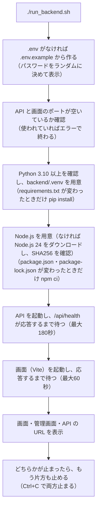

# 08 設定と運用

## 1. 設定の置き場所

| 置き場所 | 内容 | git |
| --- | --- | --- |
| `.env` | API の設定（管理者・DB・CORS・Cookie・Outlook） | 管理しない（パスワードを含む） |
| `.env.example` | `.env` のひな形。初回の起動時に、これをもとに `.env` を作る | 管理する |
| `frontend/.env.fastapi` | 画面の設定（API の接続先・ポート・公開 URL・GA4） | 管理する |
| `shared/contact_options.json` | フォームの選択肢・対応状況・都道府県 | 管理する |
| `shared/site_defaults.json` | テーマ色とサイト内容の初期値 | 管理する |
| データベースの `settings` 表 | 管理画面で変える設定（[05](05_DB設計.md) 7章） | − |

## 2. `.env`（API の設定）

値は「OS の環境変数 → `.env` → 初期値」の順に使います。変えたら API を再起動します。

| 項目 | `.env.example` の値 | 内容 |
| --- | --- | --- |
| `ADMIN_EMAIL` | `admin@example.com` | 管理者のメールアドレス（小文字にして使う）。`@` がないと起動しない |
| `ADMIN_PASSWORD` | `__GENERATE__` | 管理者のパスワード（8〜128文字）。初回の起動時に、起動スクリプトがランダムな値に置き換える。`__GENERATE__` のままだと起動しない |
| `DATABASE_PATH` | `data/app.db` | データベースのファイル。相対パスはプロジェクトのルートから |
| `HOST` | `127.0.0.1` | API の待ち受けのアドレス（起動スクリプトが読む） |
| `BACKEND_PORT` | `8000` | API のポート（起動スクリプトが読む） |
| `COOKIE_SECURE` | `false` | `true`・`1`・`yes` なら、ログインの Cookie に Secure を付ける。HTTPS で公開するときは `true` |
| `FRONTEND_ORIGINS` | `http://127.0.0.1:5173,http://localhost:5173` | API を呼んでよい画面の URL（CORS）。カンマ区切り。末尾の `/` は除いて比べる |
| `MICROSOFT_CLIENT_ID` | 空 | Outlook で送るための Azure のアプリのクライアント ID。あれば、送信方法の初期値が Outlook になる |
| `MICROSOFT_TENANT` | `consumers` | Microsoft のテナント（`consumers` は個人の Microsoft アカウント） |
| `MAIL_FROM_ADDRESS` | 空 | Outlook で送るときの送信元。空なら事業者情報のメール |
| `MAIL_FROM_NAME` | 空 | Outlook で送るときの差出人名。空なら屋号 |

書き方: `項目=値` を1行に1つ。`#` で始まる行はコメント。値は `"` か `'` で囲んでもよい。文字コードは UTF-8（BOM があってもよい）。

## 3. `frontend/.env.fastapi`（画面の設定）

| 項目 | 今の値 | 内容 |
| --- | --- | --- |
| `VITE_API_BASE_URL` | `http://127.0.0.1:8000` | API の接続先。ビルドのときに画面のファイルに埋め込む。起動スクリプトは、実際の API の URL で上書きして起動する |
| `DEV_PORT` | `5173` | 開発サーバーのポート |
| `SITE_URL` | 空 | 公開サイトの URL（`https://` から）。ビルドのときに og:image（`{SITE_URL}/ogp.png`）のタグを入れる。`https://` 以外はビルドがエラーになる。空ならタグを入れない |
| `VITE_GA_ID` | 空 | Google Analytics 4 の測定 ID（`G-` で始まる）。空なら計測しない |

`VITE_` で始まる値は画面のファイルに埋め込まれ、誰でも見られます。秘密の値は書きません。

## 4. 起動・テストで使う環境変数

| 環境変数 | 内容 |
| --- | --- |
| `HOST` / `PORT` / `WEB_PORT` | `run_backend.sh` の API の待ち受け / API のポート / 画面のポート（`.env`・`.env.fastapi` より優先） |
| `FRONTEND_ORIGINS` | 起動スクリプトが、`.env` の値に画面のポートの URL（127.0.0.1 と localhost）を足して API に渡す |
| `BLUETAB_ROOT` | プロジェクトのルート（起動スクリプトが設定する。`.env`・`shared/`・`data/` の場所） |
| `BLUETAB_TOOLS_DIR` | 起動スクリプトが Node.js を置く場所（初期 `~/.local/share/bluetab-tools`） |
| `BLUETAB_CONTACT_LIMIT` | お問い合わせの回数の上限（10分あたり。初期 10、テストでは 1000） |
| `MICROSOFT_LOGIN_URL` / `MICROSOFT_GRAPH_URL` | Microsoft の接続先（テストで偽のサーバーに向ける） |
| `WATCHFILES_FORCE_POLLING` | `--reload` のときに起動スクリプトが `true` にする（WSL から Windows のフォルダの変更を検知するため） |

## 5. ソースで変える内容

管理画面で変えられない内容は、ソースを書き換えます。画面は開発サーバーで動いているので、保存するとブラウザに反映されます（本番はビルドし直す）。

| 変えたいもの | ファイル | 注意 |
| --- | --- | --- |
| トップページの文言（キャッチコピー・特長・対応内容・経歴・安心のお約束・制作の流れ） | `frontend/src/content/home.ts`・`pages/HomePage.tsx` | 料金・よくある質問・制作実績などは管理画面（A-11） |
| 検索結果に出るタイトル・説明文 | `frontend/index.html` | タイトルを変えたら `content/home.ts` の `HOME_TITLE` も同じにする |
| 対応エリア | `content/home.ts` の `SERVICE_AREA` | `index.html` の説明文の地名もそろえる |
| ページ上部のメニュー・「ご相談はこちら」ボタン | `content/home.ts` の `NAV`・`HEADER_CTA` | 文言の半角スペースは、スマホで2行に折り返す位置（画面には出ない）。PC の1行の表示（幅 1140px 以上）は今の8個に合わせているので、項目や文字を増やすときは `styles/home.css` も見直す |
| LINE などで URL を送ったときの画像 | `frontend/public/ogp.png`（1200×630） | テーマ色を変えても、この画像の色は変わらない |
| 事業者情報ページの固定の文章 | `pages/TokushohoPage.tsx` | 表の事業者情報は管理画面（A-11） |
| 個人情報の取扱い | `components/PrivacyPolicy.tsx` | |
| フォームの選択肢・対応状況・都道府県 | `shared/contact_options.json` | 値（value）を変えるときは、マイグレーションで保存済みのデータも置き換える（[05](05_DB設計.md) 6章） |
| サイト内容の初期値 | `shared/site_defaults.json` | 管理画面で保存した項目には影響しない |
| ロゴの形 | `components/Logo.tsx`・`lib/theme.ts`（`applyBrowserColor`）・`public/favicon.svg` | 3か所をそろえる |

## 6. 起動のしかた（開発）

WSL のターミナルで `./run_backend.sh` を実行します（プロジェクトのルート `/mnt/c/Users/document/python/company` で）。

| オプション | 内容 |
| --- | --- |
| `--reload` | Python のコードを変えると API を自動で再起動する |
| `-h` / `--help` | 使い方を表示する |
| `PORT=9000 ./run_backend.sh` | API のポートを変える |
| `WEB_PORT=3000 ./run_backend.sh` | 画面のポートを変える |

ターミナルを2つ使って1つずつ起動する方法は、プロジェクトの `README.md` にあります。

## 7. テスト

`tests/run_api_tests.sh` を実行します。

| 項目 | 内容 |
| --- | --- |
| データベース | 一時フォルダのテスト用 DB（`data/app.db` には書き込まない） |
| API | ポート 18000 で起動する |
| メール | Outlook は偽の Microsoft サーバー（ポート 18999）、SMTP はテスト用の受け口（どちらも `api_test.py` が起動する）。本物には送らない |
| 回数の上限 | お問い合わせは 1000件まで（何度も送るため） |

API を3回起動して確かめます。

1. 全体のテスト: 公開サイトの API、ログイン、お問い合わせ（一覧・検索・詳細・メモ）、ページ分け、迷惑送信と削除、メール（SMTP・通知・自動返信・返信・送信履歴・テンプレート）、Outlook（サインイン・トークンの更新・送信）、CSV、テーマ色とサイト内容、見積書・入金・保守契約、データ管理と履歴、アカウント（パスワードの変更・ログアウト）
2. `.env` を変えずに再起動して、管理画面で変えたパスワードが残るか
3. `.env` のパスワードを変えて再起動して、その値にリセットされるか

すべて成功すると「すべてのテストに成功しました。」と表示します。画面の型チェックは `cd frontend && npm run typecheck` です。

## 8. 本番に公開するとき

### 8.1 画面のビルド

1. `frontend/.env.fastapi` の `SITE_URL` に公開サイトの URL を書く（例 `https://www.example.com`）。アクセス数を計測するときは `VITE_GA_ID` も書く。
2. API の公開 URL を指定してビルドする: `VITE_API_BASE_URL=https://api.example.com npm run build:fastapi`
3. 型チェックのあと、`frontend/dist/` に出力される。

### 8.2 配置の前提条件

| 項目 | 内容 |
| --- | --- |
| 画面 | `frontend/dist/` を静的ファイルとして配信する。**存在しない URL でも `index.html` を返す**（`/contact`・`/admin` などを直接開いたときも、画面側で切り替えるため）。応答ヘッダー（`X-Frame-Options`・`X-Content-Type-Options` など）も付ける |
| API | `backend/requirements.txt` を入れた Python で、Uvicorn を1プロセスで起動する（例 `uvicorn app.main:app --host 127.0.0.1 --port 8000`、`backend` フォルダで）。プロジェクトのフォルダ構成のまま置く（`.env`・`shared/`・`data/` を読むため） |
| ドメイン | 画面と API を同じドメインの配下にする（例 `www.example.com` と `api.example.com`） |
| HTTPS | 画面・API とも HTTPS。`.env` を `COOKIE_SECURE=true` にする |
| CORS | `.env` の `FRONTEND_ORIGINS` に、公開する画面の URL を書く |
| `data` フォルダ | API から書き込めること（データベース・画像・Outlook のトークン） |

### 8.3 公開したあとに管理画面で行う設定

| No. | 画面 | 設定 |
| --- | --- | --- |
| 1 | A-13 メール → 通知・自動返信 | 「サイトの URL」を公開サイトの URL にする（初期値は `http://127.0.0.1:5173` で、新着通知メールの「管理画面で確認する」のリンクが手元の URL になってしまう） |
| 2 | A-13 メール → 送信設定 | Outlook にサインイン（または SMTP を設定）して、テスト送信で届くか確かめる |
| 3 | A-11 サイト内容 → 事業者情報 | 内容を確かめる（初期値の事業形態は、開業日が「2026年10月xx日」のまま） |
| 4 | A-16 データ管理 | 個人情報の自動削除を有効にするか決める |
| 5 | A-17 アカウント | 必要ならパスワードを変える |

### 8.4 運用上の注意

| 注意 | 内容 |
| --- | --- |
| API は1プロセスで動かす | 試行回数のカウントと、Outlook のサインインの途中の情報を、プロセスのメモリに持つため。ワーカーを増やすと、サインインの確認が別のプロセスに届いて「有効期限が切れました」になり、回数の制限もプロセスごとになる。自動削除の定期処理もプロセスごとに動く |
| リバースプロキシの後ろで動かすとき | API から見た接続元が、プロキシの IP になる。そのままだと全員が同じ IP として数えられ（お問い合わせ・ログインの回数の上限にすぐ達する）、ログイン履歴の IP もすべて同じになる。プロキシに `X-Forwarded-For` を付けさせ、Uvicorn がそれを信用するようにする（Uvicorn は `--forwarded-allow-ips` に書いた IP からのヘッダーを信用する。初期値は `127.0.0.1` なので、同じサーバーのプロキシならそのまま、別のサーバーならその IP を指定する） |
| API を再起動すると消えるもの | 試行回数のカウント、Outlook のサインインの途中の情報（途中だったら、サインインをやり直す） |
| 「送信中」のまま残ったメール | 送信の途中で API が止まると、送信履歴が「送信中」のまま残る（※課題 No.5） |
| バックアップは自動ではない | 定期的に A-16 からダウンロードして保管する（9章） |

## 9. バックアップと復元

| 項目 | 内容 |
| --- | --- |
| 取り方 | A-16「バックアップをダウンロード」 |
| zip の中身 | `data/app.db`（データベースの写し）、`data/uploads/`（画像）、`README.txt`（戻し方） |
| zip に入らないもの | `.env`（別に保管する）、`data/microsoft-oauth.json`（戻したあとで Outlook にサインインし直す） |
| 戻し方 | 1. API を止める 2. zip の `data/app.db` と `data/uploads/` を、プロジェクトの `data` フォルダに上書きする 3. API を起動する |
| 保管 | zip には個人情報・管理者のパスワードのハッシュ・SMTP のパスワードが入る。他人に渡さず、不要になったら削除する |

## 10. 管理者のアカウント

| したいこと | 手順 |
| --- | --- |
| パスワードを変える | A-17 で変える（ほかの端末はログアウトされる） |
| パスワードを忘れた | `.env` の `ADMIN_PASSWORD` を新しい値（8文字以上）に書き換えて、API を再起動する。その値でログインできる |
| メールアドレスを変える | `.env` の `ADMIN_EMAIL` を書き換えて、API を再起動する。新しいメールアドレスの管理者が作られ（パスワードは `.env` の値）、古い管理者は削除される |

## 11. メールの設定

| 方法 | 手順 |
| --- | --- |
| Outlook（標準） | 1. `.env` に `MICROSOFT_CLIENT_ID`（と必要なら `MAIL_FROM_ADDRESS`・`MAIL_FROM_NAME`）を書き、API を再起動する 2. A-13 の送信設定で「Outlook にサインイン」し、表示されたページでコードを入力して、送信に使う Outlook アカウントでサインインする（コマンド `cd backend && .venv/bin/python -m app.outlook_login` でもできる） 3. テスト送信で確かめる。トークンは自動で更新する。更新できなくなったら、もう一度サインインする |
| SMTP | 1. A-13 の送信設定で送信方法を「SMTP」にする 2. サーバー名・接続方式・ポート・ユーザー名・パスワード・送信元を保存する（Gmail はアプリ パスワード） 3. テスト送信で確かめる |

送れなかったメールは、A-13 の送信履歴に理由と一緒に残ります。原因を直してから「送り直す」を押します。

## 12. よくあるトラブル

| 症状 | 原因と対処 |
| --- | --- |
| ログインしても、すぐにログイン画面に戻る | 画面と API の URL の、ホスト名・ドメインが合っていない（Cookie が送られない）。開発では 127.0.0.1 と localhost を混ぜない（画面は自動でそろえる）。本番では画面と API を同じドメインの配下にし、HTTPS で開く（`COOKIE_SECURE=true` のときは HTTP では送られない） |
| 画面に「通信に失敗しました」と出る | API が動いていない、`VITE_API_BASE_URL` が違う、`FRONTEND_ORIGINS` に画面の URL がない（CORS で止められる） |
| 「ポート 8000 は既に使われています」 | 別の起動コマンドが動いている。止めるか、`PORT=番号` を付けて起動する |
| 手で起動したときに `npm` が見つからない | ターミナルで `export PATH="$HOME/.local/share/bluetab-tools/node/bin:$PATH"` を実行する（ターミナルを開くたびに必要） |
| 起動時に「.env の ADMIN_PASSWORD は 8〜128 文字で設定してください。」 | `.env` の `ADMIN_PASSWORD` を直す |
| メールが届かない | A-13 の状態と送信履歴の理由を見る（未設定・未サインイン・認証のエラーなど）。直してから「送り直す」 |
| 新着通知メールのリンクが 127.0.0.1 になる | A-13 の通知・自動返信の「サイトの URL」を、公開サイトの URL にする |
| LINE などで URL を送っても画像が出ない | `SITE_URL` を書いて、ビルドし直す |
| 本番で `/contact` などを直接開くと 404 | 静的ファイルの配信で、存在しない URL に `index.html` を返す設定がない（8.2） |
